## Options buy a choice about interest-rate exposure

<b>Interest-rate exposure</b>Bond, yield or futures-price risk<i>→</i><b>Option contract</b>Pay premium; choose whether to exercise<i>→</i><b>Desired payoff</b>Protection, upside or premium income

The buyer has a right without an obligation. The seller receives premium and accepts the corresponding obligation. A futures contract locks in an outcome; an option buys a choice.

## From a yield shock to a protective put

A yield rise usually lowers ordinary fixed-rate bond and Treasury futures prices. A **put** gains from that price decline; a **call** gains when the underlying price rises.

$$\Delta P\approx-PD_{\mathrm{mod}}\Delta y$$

For a $10 million portfolio with modified duration 8 and a +25 bp shock:

$$\Delta P\approx-\$10{,}000{,}000(8)(0.0025)=-\$200{,}000.$$

Choose the payoff shape first. Then size the hedge using its sensitivity to the portfolio’s risk.

## Calls and puts allocate rights and obligations

| Position | Right or obligation | Market view | Maximum loss at expiration |
|---|---|---|---|
| Long call | Right to buy | Underlying price will rise | Premium paid |
| Short call | Obligation to sell if assigned | Underlying will not rise much | Potentially very large |
| Long put | Right to sell | Underlying price will fall | Premium paid |
| Short put | Obligation to buy if assigned | Underlying will not fall much | Large if underlying collapses |

Strike **K** is the exercise price. Expiration is the final date the right exists. The buyer is long and pays premium; the writer is short and receives it.

## Exercise, assignment and the underlying futures

| Option exercised | Holder receives | Assigned writer receives |
|---|---|---|
| Call | Long futures at K | Short futures at K |
| Put | Short futures at K | Long futures at K |

New futures positions are marked to market. Clearing handles assignment. Traders often close an option with an offsetting trade instead of exercising early.

American exercise is available on eligible days through expiration; European exercise occurs at expiration. Contract specifications determine the exact rules. The option delivers a **futures position**, which then has its own margin requirements.

## Options versus futures: commitment and cash

| Feature | Futures contract | Option contract |
|---|---|---|
| Economic commitment | Both sides are obligated | Buyer has a right; writer has an obligation |
| Upfront price | Normally no purchase price; margin is posted | Buyer pays premium under traditional premium style |
| Payoff | Symmetric | Asymmetric |
| Long's downside | Falls one-for-one with futures price | Long option loss is limited to premium |
| Time value | No option time value | Premium normally includes time value |
| Main use | Lock in or linearly change exposure | Protect, retain upside, or sell contingent exposure |

## Example 1: lock the outcome or buy protection

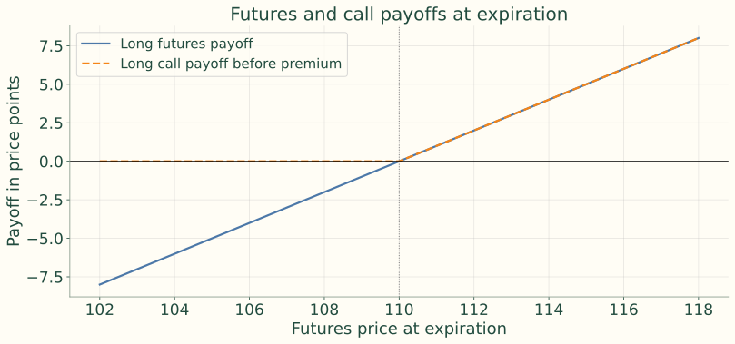{.board-figure}

<h3>Sell futures</h3>
A price decline creates gains; a price rise creates losses. Linear hedging gives up both sides of the mapped exposure.

<h3>Buy puts</h3>
Pay premium for protection below the strike. If prices rise, let puts expire and retain portfolio gains less premium.

Both respond to fear of falling Treasury prices over the next three months; they serve different payoff objectives.

## Cash bonds, rates and futures have different option contracts

| Underlying | Contract and use |
|---|---|
| Specific cash bond | Call or put on its price; coupon, maturity and duration affect value |
| Interest rate | Cap protects borrowers above a rate strike; floor protects investors below it |
| Swap | Swaption gives the right to enter a swap |
| Futures | Option on a specified Treasury or short-rate futures contract |

Cash-bond and rate options can have customized OTC terms. Exchange-traded futures options use standardized contracts and central clearing.

## A complete futures-option instruction

<b>Buy one</b>Long option; pay premium<i>→</i><b>September 10-year Treasury futures</b>Identify the exact underlying contract<i>→</i><b>110 call</b>Right to become long futures at strike 110

Also identify option expiration, exercise style, contract unit, quotation, premium and margin convention. The option date need not be inferred from the futures month.

## A December 110 put: quote, payoff and profit {.worked}

Premium **0-40** means $40/64=0.625$ price point in this example. With $1,000 per point, the premium is **$625**.

| Futures at expiry | Put payoff | Profit after premium |
|---:|---:|---:|
| 114 | $0 | −$625 |
| 110 | $0 | −$625 |
| 109.375 | $625 | $0 |
| 107 | $3,000 | $2,375 |

At 107, exercise creates short futures at 110, worth $(110-107)\times\$1{,}000=\$3{,}000$ before premium. Strike 110 is an index price, not $110.

## Example 2: exercise a 110 call at 112

<b>Exercise</b>Long futures at 110<i>→</i><b>Immediate value</b>(112 − 110) × $1,000 = $2,000<i>→</i><b>Premium</b>0-48 = 48/64 × $1,000 = $750<i>→</i><b>Net profit</b>$2,000 − $750 = $1,250

The example ignores fees and cash-flow timing.

**Units:** premium 1-16 means $1+16/64=1.25$ points = $1,250. Futures 109.375 means $109+12/32$, written 109-12. Price points, dollars and yield basis points are distinct.

## Margin conventions change the cash-flow mechanics

<h3>Premium paid upfront</h3>
Buyer pays premium and normally does not post the same performance margin as an uncovered writer. Writer posts margin for contingent obligations.

<h3>Futures-style margining</h3>
Premium is not fully exchanged initially. Changes generate settlement variation; premium settles at close, exercise or expiry.

Portfolio offsets affect clearing margin. Exercise creates futures positions with their own margin requirements.

## Contract units and quote conventions {.worked}

| Option family | Underlying unit | Quote intuition |
|---|---:|---|
| 2Y / 3Y Treasury note futures | $200,000 face | Price points and fractions |
| Other Treasury note/bond futures shown | $100,000 face | Price points and fractions |
| Three-Month SOFR futures | $1 million reference notional | One futures bp is $25 |

Contract size, expiration, exercise, tick and margin rules depend on the exact product. The worked Treasury examples use **$1,000 per point** and explicitly stated premium fractions.

## Intrinsic value, time value and Example 3 {.worked}

$$\text{Premium}=\text{intrinsic value}+\text{time value}$$

$$\text{Call intrinsic}=\max(S-K,0),\qquad\text{put intrinsic}=\max(K-S,0)$$

**Example 3:** call strike 110, current futures 112, premium 2.75 points.

| Component | Calculation | At $1,000 per point |
|---|---|---:|
| Intrinsic | $\max(112-110,0)=2.00$ | $2,000 |
| Time value | $2.75-2.00=0.75$ | $750 |
| Total | $2.00+0.75=2.75$ | $2,750 |

A call is in the money when price exceeds strike; a put is in the money when price is below strike.

## Time value reflects the remaining choice

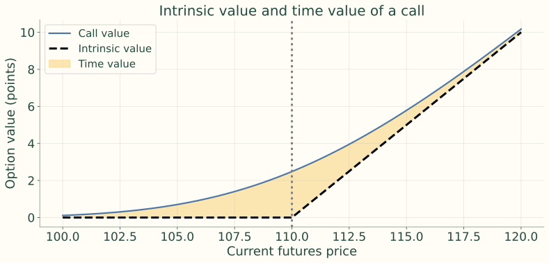{.board-figure}

Time value tends to zero at expiration and is usually greatest near the strike. This illustration sets $r=0$ so European option value and immediate-exercise intrinsic use the same value basis.

## Expiration payoff versus profit

<h3>Payoff</h3>
Exercise value at expiration, before the initial premium.

<h3>Profit</h3>
Payoff less premium for a buyer; premium less payoff for a writer.

Let c and p be call and put premiums and Sₜ the expiration price. The following profit diagrams use K = 110, c = 3.00 and p = 2.50, ignoring financing and fees.

## Long call: expiration profit

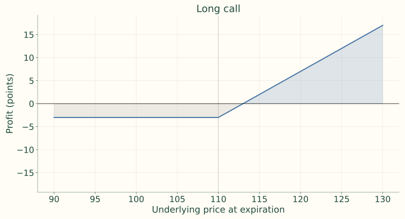{.board-figure}

$$
\Pi=\max(S_T-K,0)-c
$$

Maximum loss c; break-even K + c = 113. Benefits from higher prices, usually falling yields. Potential upside is large; the ordinary-asset model has no upper bound.

## Short call: expiration profit

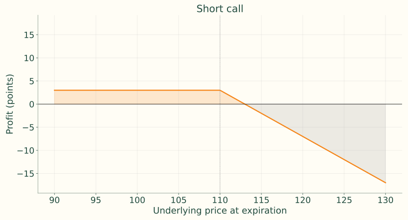{.board-figure}

$$
\Pi=c-\max(S_T-K,0)
$$

Maximum gain c; break-even K + c = 113. A naked writer accepts potentially very large losses if prices rise.

## Long put: expiration profit

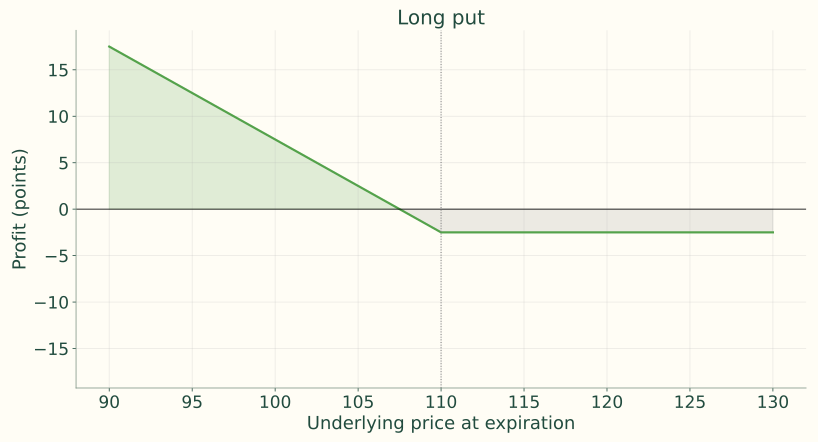{.board-figure}

$$
\Pi=\max(K-S_T,0)-p
$$

Maximum loss p; break-even K − p = 107.5. Maximum gain K − p if price can fall to zero. Usually benefits from rising yields.

## Short put: expiration profit

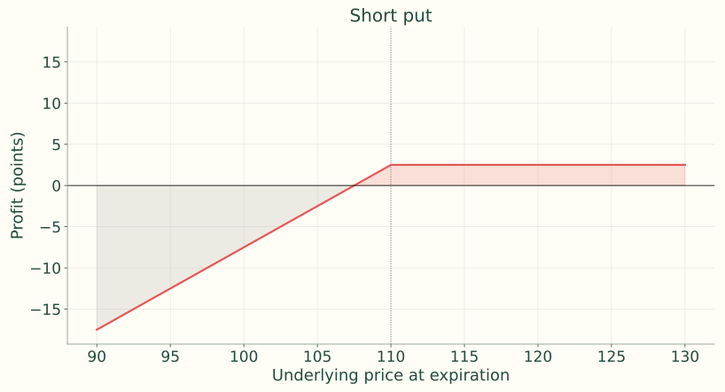{.board-figure}

$$
\Pi=p-\max(K-S_T,0)
$$

Maximum gain p; break-even K − p = 107.5. Loss can be large if the underlying falls sharply.

## Example 4: profit on a 110 put costing 1.50

| Futures price at expiration | Put payoff | Profit after premium |
|---:|---:|---:|
| 114 | 0.00 | -1.50 |
| 110 | 0.00 | -1.50 |
| 108.5 | 1.50 | 0.00 |
| 105 | 5.00 | 3.50 |

$$
\text{Break-even}=110-1.50=108.50
$$

At 105, payoff is 5.00 points and profit is 3.50 points. Above 110, the loss is the 1.50-point premium.

## Put-call parity: equal terminal payoffs

$$C+Ke^{-rT}=P+S_0,\qquad C-P=S_0-Ke^{-rT}$$

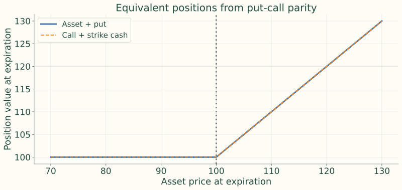{.board-figure}

For European options on a non-coupon-paying asset, **call + strike cash** and **underlying + put** both pay $\max(S_T,K)$ at expiration.

## Parity with coupons, futures and synthetic positions {.worked}

$$C-P=(B_0-I)-Ke^{-rT},\qquad c-p=e^{-rT}(F_0-K)$$

$I$ is the PV of coupons before expiry. The futures relation assumes European exercise and premium paid upfront.

| Desired position | Equivalent for the non-coupon asset |
|---|---|
| Long call | Long put + underlying − risk-free bond paying $K$ |
| Long put | Long call − underlying + risk-free bond paying $K$ |
| Long underlying | Long call − long put + risk-free bond paying $K$ |

Use identical maturity and strike; adjust for interim income.

## Example 5: parity and the arbitrage trade {.worked}

**Inputs:** $S_0=98$, $K=100$, $T=0.5$, $r=4\%$, $C=3.80$.

$$P=C-S_0+Ke^{-rT}=3.80-98+100e^{-0.02}=3.8199.$$

If the identical put trades at **4.50**:

| Trade | Initial cash flow |
|---|---:|
| Short underlying and put | $98+4.50=102.50$ received |
| Buy call and strike cash | $3.80+98.0199=101.8199$ paid |
| Net receipt | **0.6801** |

The terminal packages offset. This comparison assumes borrowing/shorting access and negligible transaction costs.

## Six inputs shape option value

| Input rises | Ordinary cash-asset call | Ordinary cash-asset put |
|---|---|---|
| Underlying price | Rises | Falls |
| Strike | Falls | Rises |
| Time | Usually rises | Usually rises |
| Risk-free rate | Usually rises | Usually falls |
| Interim coupon PV | Falls | Rises |
| Price volatility | Rises | Rises |

Hold other inputs fixed. American time flexibility helps; European discounting and coupon timing can complicate the time effect. Futures-model rate effects differ.

## Bond price, coupons and the rate input

| Change | Pricing effect, other inputs fixed |
|---|---|
| Higher cash-asset price | Call rises, put falls |
| Higher risk-free rate | Discounted strike falls; cash-asset call usually rises, put falls |
| Larger interim coupon PV $I$ | Adjusted underlying $S_0-I$ falls; call falls, put rises |

A market rate rise can simultaneously **lower the bond price**. Include that movement as well as the direct discount-rate effect.

$$\Delta P/P\approx-D_{\mathrm{mod}}\Delta y$$

Distinguish percentage price volatility from yield volatility in basis points.

## Price and strike sensitivities

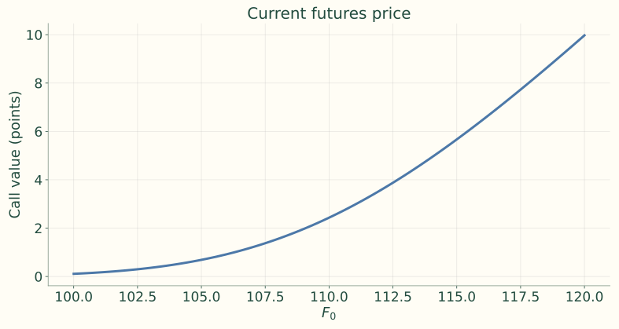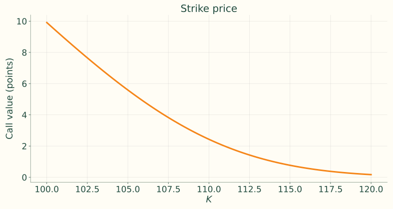

Benchmark: $F_0=K=110$, $T=0.5$, $r=4\%$, $\sigma=8\%$. Change only the plotted input. More dispersion makes the buyer’s choice more valuable; European time effects also depend on discounting.

## Time and volatility sensitivities

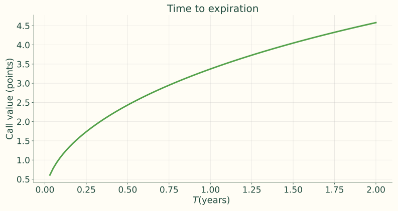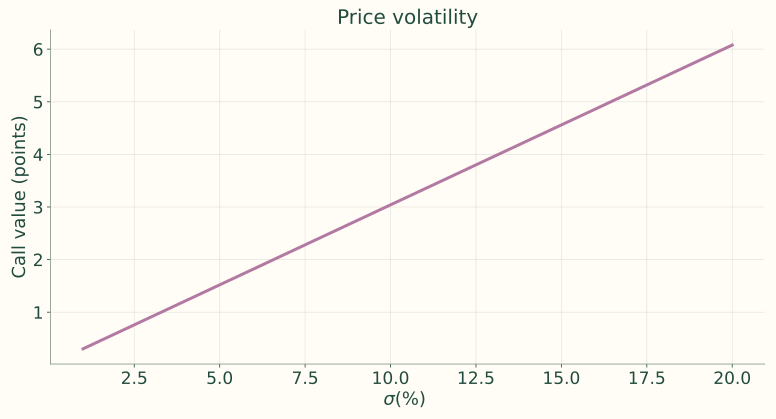

Benchmark: $F_0=K=110$, $T=0.5$, $r=4\%$, $\sigma=8\%$. Change only the plotted input. More dispersion makes the buyer’s choice more valuable; European time effects also depend on discounting.

## Moneyness, time and volatility interact

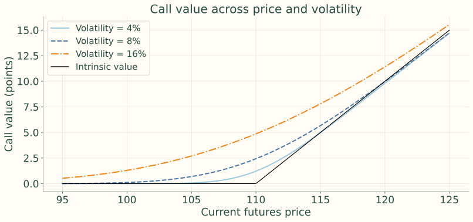{.figure}

Near the strike, uncertainty most visibly changes exercise prospects. With positive discounting, a European futures option can lie below immediate-exercise intrinsic far in the money; the right cannot be exercised early.

## Valuation models: replicate and discount

<b>States</b>Describe future underlying prices<i>→</i><b>Payoffs</b>Apply the exercise rule in each state<i>→</i><b>No arbitrage</b>Replicate or use pricing probabilities<i>→</i><b>Value today</b>Discount at the appropriate risk-free rate

A model specifies future prices and exercise opportunities. Its assumptions must fit the underlying and contract.

## Black–Scholes for a non-coupon-paying asset

$$
C=S_0N(d_1)-Ke^{-rT}N(d_2)
$$

$$
d_1=\frac{\ln(S_0/K)+(r+\sigma^2/2)T}{\sigma\sqrt T},\qquad d_2=d_1-\sigma\sqrt T
$$

$$
P=Ke^{-rT}N(-d_2)-S_0N(-d_1)
$$

$S_0$ is the underlying price, $K$ the strike, $T$ years to expiry, $r$ the continuously compounded rate and $\sigma$ annualized price volatility. $N$ is the standard normal CDF. For interim coupon PV $I$, replace $S_0$ with $S_0-I$.

## Example 6: zero-coupon option inputs and probabilities {.worked}

**European option:** $S_0=92$, $K=90$, $T=0.5$ years, continuously compounded $r=4\%$, annualized price volatility $\sigma=10\%$. No interim coupon.

$$d_1=\frac{\ln(92/90)+[0.04+0.10^2/2](0.5)}{0.10\sqrt{0.5}}=0.6290$$

$$d_2=d_1-0.10\sqrt{0.5}=0.5583$$

| Probability | $N(d_1)$ | $N(d_2)$ | $N(-d_1)$ | $N(-d_2)$ |
|---|---:|---:|---:|---:|
| Rounded value | 0.7353 | 0.7117 | 0.2647 | 0.2883 |

$N$ is the standard normal CDF. Use full precision internally.

## Example 6: call, put and parity {.worked}

**Same inputs:** $S_0=92$, $K=90$, $T=0.5$, $r=4\%$, $\sigma=10\%$.

$$C=92N(0.6290)-90e^{-0.02}N(0.5583)=4.8673$$

$$P=90e^{-0.02}N(-0.5583)-92N(-0.6290)=1.0852$$

| Check | Calculation |
|---|---|
| Intrinsic and time value | $2.0000+2.8673=4.8673$ |
| Call minus put | $4.8673-1.0852=3.7821$ |
| Underlying minus strike PV | $92-90e^{-0.02}=3.7821$ |

Final values use unrounded $d$ and CDF values. Black–Scholes assumes lognormal price, constant volatility/rate and frictionless continuous hedging.

## Example 6 extension: an interim coupon {.worked}

The bond pays a coupon of **2.00** before expiry, with PV **1.96**. Keep $K=90$, $T=0.5$, $r=4\%$, $\sigma=10\%$.

$$S_0-I=92-1.96=90.04$$

$$d_1=\frac{\ln(90.04/90)+[0.04+0.10^2/2](0.5)}{0.10\sqrt{0.5}}=0.3245,\quad d_2=0.2538$$

$$C_{\mathrm{coupon}}=90.04N(d_1)-90e^{-0.02}N(d_2)=3.5291$$

The call falls by $4.8673-3.5291=1.3382$, less than the coupon PV of 1.96 because call delta is below one. The option holder misses the interim coupon.

## CRR: volatility sets branches, no arbitrage sets weights {.worked}

$$\Delta t=T/N,\quad u=e^{\sigma\sqrt{\Delta t}},\quad d=1/u,\quad q=\frac{e^{r\Delta t}-d}{u-d}$$

**Example 6 with 100 steps:** $S_0=92$, $T=0.5$, $r=4\%$, $\sigma=10\%$.

| Quantity | Substitution and result |
|---|---|
| Time step | $\Delta t=0.5/100=0.005$ |
| Up / down factors | $u=1.007096$, $d=0.992954$ |
| First prices | $92u=92.6528$, $92d=91.3518$ |
| Pricing weights | $q=0.512376$, $1-q=0.487624$ |

Require $d<e^{r\Delta t}<u$. With income yield $y$, use $r-y$ in the carry term. $q$ is a pricing weight, not a forecast.

## One-period tree: replication on the same diagram {.worked}

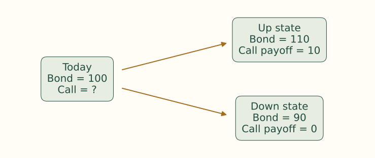{.board-figure}

Strike 100; one-year risk-free gross return 1.05. Match both terminal payoffs:

$$110\Delta+1.05B=10,\quad90\Delta+1.05B=0$$

$$\Delta=0.5,\quad B=-42.857,\quad C_0=0.5(100)-42.857=7.143.$$

Equivalently, $q=(1.05-0.90)/(1.10-0.90)=0.75$ and $C_0=[0.75(10)+0.25(0)]/1.05=7.143$.

## Backward induction and convergence {.worked}

$$V_t=e^{-r\Delta t}[qV^u_{t+\Delta t}+(1-q)V^d_{t+\Delta t}]$$

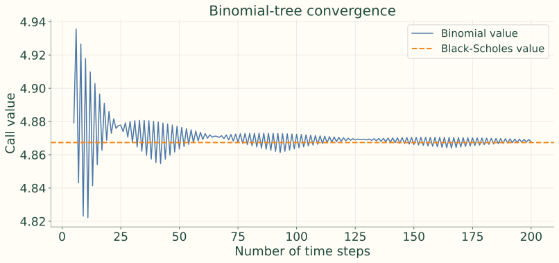{.board-figure}

Start with terminal payoffs. For American options, take the larger of continuation and immediate exercise at each node.

For Example 6: **100-step call 4.8723**, Black–Scholes **4.8673**, difference **0.0050**. Strike placement causes the narrowing saw-tooth pattern.

## Implied volatility: solve the price equation {.worked}

For the Example 6 call ($S_0=92$, $K=90$, $T=0.5$, $r=4\%$), observe a price of **4.25** and solve $C(\sigma)=4.25$.

| Trial volatility | Call price | Next move |
|---:|---:|---|
| 5.000% | 3.9655 | Raise volatility |
| 6.500% | 4.1878 | Raise volatility |
| 7.000% | 4.2741 | Lower volatility |
| 6.800% | 4.2390 | Raise volatility |
| 6.863% | 4.2500 | Match |

$$\sigma_{\mathrm{implied}}\approx6.863\%$$

Implied volatility reproduces the quote under the model. Risk premiums, liquidity and model assumptions affect it as well as expected realized volatility.

## A volatility smile reveals the constant-volatility limitation

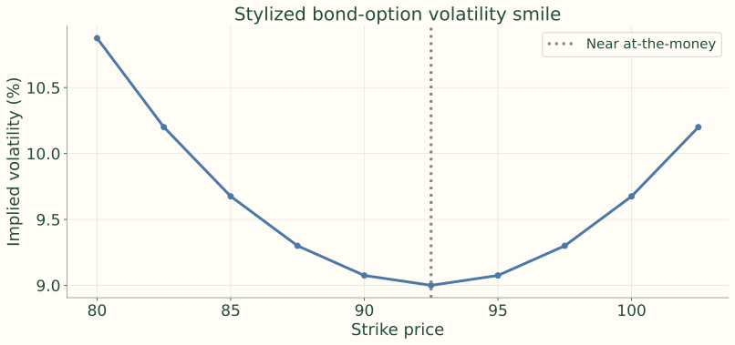{.figure}

Stylized illustration; no observed market quotes. A smile or skew means a single constant lognormal volatility does not fully describe prices across strikes.

## Black’s model values European futures options

$$
c=e^{-rT}[F_0N(d_1)-KN(d_2)]
$$

$$
p=e^{-rT}[KN(-d_2)-F_0N(-d_1)]
$$

$$
d_1=\frac{\ln(F_0/K)+\tfrac12\sigma^2T}{\sigma\sqrt T},\qquad d_2=d_1-\sigma\sqrt T
$$

Both terms are inside the discount factor. No separate carry term enters d₁: F₀ already reflects carry under the model.

## Example 7: futures-option inputs and probabilities {.worked}

**Treasury futures:** $F_0=111$, $K=110$, $T=0.25$ years, $r=4.5\%$, $\sigma=8\%$. One point is **$1,000**.

$$d_1=\frac{\ln(111/110)+\tfrac12(0.08)^2(0.25)}{0.08\sqrt{0.25}}=0.2462$$

$$d_2=d_1-0.04=0.2062,\qquad e^{-rT}=e^{-0.01125}=0.9888$$

| $N(d_1)$ | $N(d_2)$ | $N(-d_1)$ | $N(-d_2)$ |
|---:|---:|---:|---:|
| 0.5973 | 0.5817 | 0.4027 | 0.4183 |

Use full precision for the premiums. Both futures-price and strike terms receive the discount factor.

## Example 7: premiums and the parity check {.worked}

**Same inputs:** $F_0=111$, $K=110$, $T=0.25$, $r=4.5\%$, $\sigma=8\%$.

$$c=e^{-0.01125}[111N(d_1)-110N(d_2)]=2.2823\text{ points}$$

$$p=e^{-0.01125}[110N(-d_2)-111N(-d_1)]=1.2935\text{ points}$$

| Result | Dollar premium at $1,000 per point |
|---|---:|
| Call | $2,282.32 |
| Put | $1,293.50 |

$$c-p=0.9888=e^{-0.01125}(111-110)$$

Use unrounded probabilities and premiums for the dollar conversion and equality.

## Choose a model that matches the problem

| Model | Useful for | Limitation to remember |
|---|---|---|
| Black / Black–Scholes | Benchmark prices and implied-volatility quotes | Lognormal constant-volatility approximation |
| Binomial tree | Early exercise and discrete choices | Grid and underlying dynamics matter |
| Short-rate / term-structure model | Future curves, path dependence, many cash-flow dates | Calibration and model risk |

Black does not explain how all maturities move together. Models such as Hull–White can generate internally consistent future curves.

## Protective puts: exposure and delta determine the count

$$\mathrm{DV01}_P\approx PD_{\mathrm{mod}}(0.0001),\quad N_{\mathrm{fut\text{-}eq}}\approx\frac{\mathrm{DV01}_P}{\mathrm{DV01}_{\mathrm{futures}}}$$

$$\Delta=\frac{\partial V}{\partial F},\qquad N_{\mathrm{puts}}\approx\frac{\mathrm{DV01}_P}{|\Delta_{\mathrm{put}}|\,\mathrm{DV01}_{\mathrm{futures}}}$$

A put with delta −0.40 supplies 0.40 short futures equivalents initially. Delta changes with price, time and volatility, so a local hedge requires rebalancing. Adjust for yield beta or key-rate differences when exposures differ.

## Example 8: inputs and portfolio exposure {.worked}

| Input | Value |
|---|---:|
| Bond portfolio / modified duration | $10 million / 8.0 |
| Current futures F₀ / put strike K | 110 / 110 |
| Futures DV01 | $80 per contract |
| Put premium / current delta | 1.25 points / −0.40 |
| Dollar value of one price point | $1,000 |

$$\mathrm{DV01}_P=10{,}000{,}000(8)(0.0001)=\$8{,}000,\quad N_{\mathrm{fut\text{-}eq}}=8{,}000/80=100.$$

A 1 bp yield rise costs about $8,000. The simplified mapping treats the portfolio as **100 long futures equivalents**.

## Example 8: a local hedge versus an expiration floor {.worked}

**Inputs:** 100 long futures equivalents; put $K=110$, premium 1.25 points, delta −0.40; $1,000 per point.

| Design | Put count | Initial net exposure | Premium |
|---|---:|---:|---:|
| Local delta hedge | $100/0.40=250$ | $100-250(0.40)=0$ | $312,500 |
| Static expiration overlay | 100 | $100-100(0.40)=60$ long | $125,000 |

For a small one-point decline, 250 puts gain about $250(0.40)(\$1{,}000)=\$100{,}000$, offsetting the mapped loss.

The **100-put static overlay** instead offsets losses one-for-one below strike at expiry. Use that design in the following scenarios.

## Example 8: build the protected result {.worked}

**Static design:** 100 puts, $F_0=K=110$, premium cost $125,000.

$$\Delta V_{\mathrm{bond,mapped}}=100(\$1{,}000)(F_T-110)$$

$$\text{Put payoff}=100(\$1{,}000)\max(110-F_T,0)$$

$$\Delta V_{\mathrm{protected}}=\Delta V_{\mathrm{bond,mapped}}+\text{put payoff}-\$125{,}000$$

At $F_T=107$: $-\$300{,}000+\$300{,}000-\$125{,}000=-\$125{,}000$.

Assume the DV01 mapping holds and ignore basis and convexity differences. These are changes relative to the initial bond value, including premium.

## Example 8: the static protective floor {.worked}

100 puts, $K=110$, premium cost **\$125,000**. All table amounts are **thousands of dollars**.

::::: {.columns}
:::: {.column width="52%"}
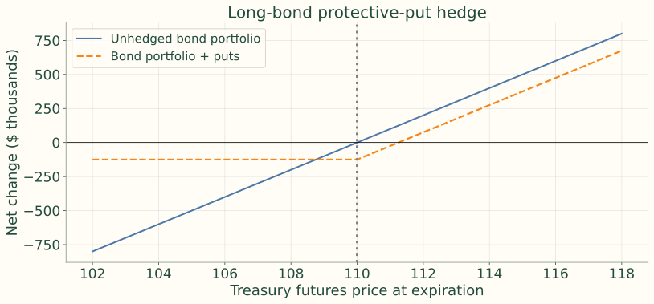{.board-figure}
::::
:::: {.column width="48%"}
| $F_T$ | Bond change | Put payoff | Net |
|---:|---:|---:|---:|
| 104 | −600 | 600 | −125 |
| 107 | −300 | 300 | −125 |
| 110 | 0 | 0 | −125 |
| 113 | 300 | 0 | 175 |
| 116 | 600 | 0 | 475 |
::::
:::::

Below 110, the put payoff offsets each additional mapped loss. Above 110, mapped gains remain less premium. Basis, curve and convexity differences affect the actual cash-bond hedge.

## Practical hedge risks remain after sizing

| Risk | What can change |
|---|---|
| Basis and CTD | Portfolio and delivery-linked futures respond differently |
| Curve | One future cannot cover every maturity point |
| Delta drift | Price, time and volatility change option sensitivity |
| Volatility | Put value changes without a rate move |
| Expiration | Hedge ends before exposure ends |
| Liquidity and costs | Rolling and rebalancing are costly |

## Covered calls: premium income in exchange for upside

$$
\Pi_{\mathrm{covered\ call}}=(F_T-F_0)+c-\max(F_T-K,0)
$$

<h3>Below the strike</h3>
Call expires worthless. Premium cushions losses by only a fixed amount.

<h3>Above the strike</h3>
Short-call losses offset additional underlying gains.

Formula is per futures-equivalent unit and one written call; actual cash bonds introduce basis risk.

A one-for-one overwrite caps gains above the strike while providing only the fixed premium as a downside cushion.

## Example 9: inputs and overwrite counts {.worked}

**Same portfolio:** $10 million, DV01 $8,000; futures DV01 **\$80 per contract**, hence **100 long equivalents**. $F_0=110$, call $K=113$, premium 1.00 point, delta +0.40; $1,000 per point.

| Design | Short calls | Initial net exposure | Consequence |
|---|---:|---:|---|
| Local delta hedge | $100/0.40=250$ | 0 | Can become overhedged as delta rises |
| Static one-for-one overwrite | 100 | $100-100(0.40)=60$ long | Caps the mapped gain at expiration |

Use **100 short calls** below. Premium income is $100(1.00)(\$1{,}000)=\$100{,}000$. A 250-call position needs rebalancing and is not fully covered one-for-one.

## Example 9: components and two worked outcomes {.worked}

**Static design:** 100 short calls, $K=113$, premium 1 point; $F_0=110$.

$$\Delta V_{\mathrm{bond,mapped}}=100(\$1{,}000)(F_T-110)$$

$$\Pi_{\mathrm{short\ calls}}=100(\$1{,}000)[1-\max(F_T-113,0)]$$

| $F_T$ | Mapped bond change | Short-call profit | Combined |
|---:|---:|---:|---:|
| 107 | −$300,000 | $100,000 | −$200,000 |
| 119 | $900,000 | $100,000 − $600,000 | $400,000 |

Above 113, additional mapped gains offset written-call losses. Maximum net gain is $100(\$1{,}000)[(113-110)+1]=\$400{,}000$.

## Example 9: the static covered-call cap {.worked}

100 short calls, $K=113$, premium received **\$100,000**. All table amounts are **thousands of dollars**.

::::: {.columns}
:::: {.column width="52%"}
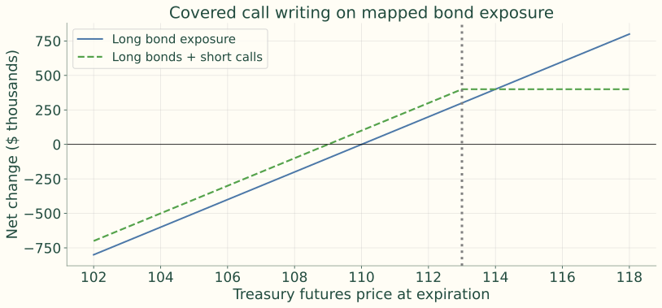{.board-figure}
::::
:::: {.column width="48%"}
| $F_T$ | Bond change | Call profit | Net |
|---:|---:|---:|---:|
| 104 | −600 | 100 | −500 |
| 107 | −300 | 100 | −200 |
| 110 | 0 | 100 | 100 |
| 113 | 300 | 100 | 400 |
| 116 | 600 | −200 | 400 |
| 119 | 900 | −500 | 400 |
::::
:::::

The premium gives a fixed $100,000 cushion. Above 113, mapped gains cap at $400,000. The portfolio–futures basis and DV01 mapping can change.

## Protective puts and covered calls serve different objectives

| Strategy | Premium cash flow | Downside | Upside | Typical objective |
|---|---:|---|---|---|
| Long bond + long put | Pay premium | Floored below strike, subject to basis risk | Retained | Insurance |
| Long bond + short call | Receive premium | Only slightly cushioned | Capped above strike | Income enhancement |

Protective puts buy convexity; covered calls sell it. Choose using objectives, constraints, valuation and tail-risk tolerance, not premium alone.

## From the risk to the hedge

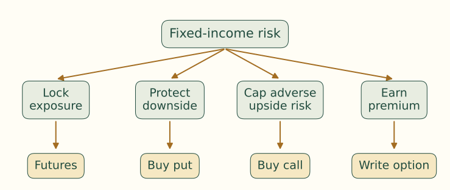{.board-figure}

Choose the payoff, then size with DV01, key-rate exposure, beta and delta. Stress basis, volatility, time decay, exercise, liquidity, margin and model risk. Compare with an unhedged position and a futures hedge.

## Check understanding: direction, units and hedge count

1. If 10-year yields rise sharply, which option on Treasury futures protects a long bond portfolio? Trace the price effect.
2. A 110 put costs 0-32 under the example’s 64ths convention. What are its dollar premium and expiry break-even?
3. Why does a −0.25-delta put require more contracts than portfolio DV01 divided by futures DV01?
4. Does risk-neutral probability or implied volatility give an exact real-world forecast?

## Answers: trace the exposure and the units

1. **Buy puts:** higher yields usually lower Treasury futures prices, increasing put payoffs.
2. $32/64=0.5$ point = **$500**; break-even $110-0.5=109.5$.
3. Each put supplies 0.25 short futures equivalents initially, so the local hedge needs about four puts per equivalent unit.
4. **No.** Risk-neutral weights enforce no-arbitrage pricing. Implied volatility matches a quote under a model and also reflects risk premiums, liquidity and model limitations.

## Contracts, valuation and hedge objectives

| Decision | What to check |
|---|---|
| Contract | Underlying, strike, expiration, exercise, quote and margin units |
| Value | Intrinsic/time value, parity, appropriate model and volatility |
| Hedge | DV01 and delta; local rebalanced hedge versus static expiry overlay |
| Objective | Puts buy a floor and retain upside; covered calls sell upside for premium |

The buyer chooses whether to exercise. The assigned writer must perform. Premium income leaves tail risk; a hedge’s payoff objective determines its design.
