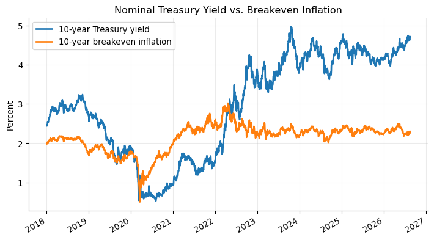
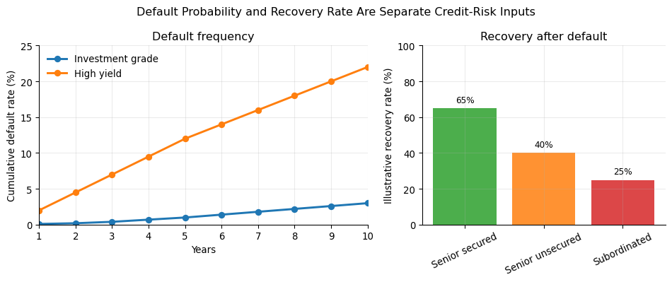
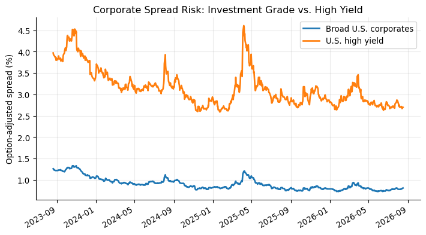

## Debt instruments at a glance

| Market | Main instruments | Pricing connection |
|---|---|---|
| Treasury | Bills, notes, bonds, FRNs, TIPS, STRIPS | Benchmark dollar rates |
| Federal agency / GSE | Agency debt and mortgage-backed securities | Treasury yield plus agency spread |
| Corporate | Bonds, MTNs, structured notes | Base rate plus credit / structure spread |
| Corporate short-term funding | Commercial paper, bank loans | Short-term benchmark plus spread |
| Securitized loans | CLO tranches | Loan cash flows and payment priority |

::: {.notes}
One-hour pacing: overview 2 minutes, Treasuries 27 minutes, agencies 3 minutes, corporate instruments 18 minutes, credit risk and wrap-up 10 minutes. Examples are teaching assumptions. Charts reproduce the existing Lecture 5 notes and are historical snapshots, not live feeds.
:::

## Treasury instruments and pricing

| Instrument | Cash flows | Pricing connection |
|---|---|---|
| Bill | One payment at maturity | Discount from face value |
| Note / bond | Fixed coupons plus principal | Present value of promised cash flows |
| FRN | Floating coupons plus fixed principal | Bill reference rate plus fixed spread |
| TIPS | Fixed coupon rate on indexed principal | Real yield and inflation adjustment |
| STRIP | One separated coupon or principal payment | A maturity-specific discount factor |

## Treasury risk exposures

| Security | Dominant exposure | Why it exists |
|---|---|---|
| Bill | Short rates and reinvestment | Short-term funding and cash investment |
| Note | Nominal duration | Benchmark funding across maturities |
| Bond | Long nominal duration | Long-term funding and liability matching |
| FRN | Changes in coupon income | Treasury exposure with low rate duration |
| TIPS | Real rates and realized CPI inflation | Purchasing-power protection |
| STRIP | Zero-coupon duration | Exact future cash-flow matching |

## Fixed-principal Treasury securities

| Security | Original maturity | Interest payments |
|---|---|---|
| Bills | Up to 1 year | No coupons, principal at maturity |
| Notes | 2, 3, 5, 7, or 10 years | Semiannual fixed coupons |
| Bonds | 20 or 30 years | Semiannual fixed coupons |
| Floating-rate notes | 2 years | Quarterly floating coupons |

All repay fixed nominal principal. FRN interest accrues using a reference rate that resets weekly, plus a fixed spread.

::: {.notes}
Distinguish payment frequency from reset frequency. The FRN reference is the most recent 13-week bill auction high rate. These standard issue terms describe the instruments, not an auction calendar.
:::

## Example: pricing a Treasury bill

Face value $F=\$10{,}000$, discount yield $r_d=4.75\%$, maturity $d=91$ days.

$$P=F\left(1-r_d\frac{d}{360}\right)$$

$$P=10{,}000\left(1-0.0475\frac{91}{360}\right)=\$9{,}879.93$$

The investor pays **\$9,879.93** and receives **\$10,000** at maturity. Interest earned is **\$120.07**.

## Treasury inflation-protected securities

- CPI inflation adjusts principal. The coupon rate stays fixed.
- Semiannual coupon = annual coupon rate / 2 × adjusted principal.
- At maturity, repayment is the greater of adjusted or original principal.
- Prices can fall before maturity when real yields rise.

$$\text{Breakeven inflation}\approx y_{\text{nominal Treasury}}-y_{\text{TIPS real}}$$

For matched maturities, nominal yield 4.5% minus real yield 2.0% implies breakeven inflation of **2.5%**.

## Nominal yields and breakeven inflation

{height=510px fig-alt="Historical 10-year nominal Treasury yields and breakeven inflation. Their gap approximates the real yield."}

::: {.small}
The gap approximates the real yield. Breakeven also includes inflation-risk and liquidity premiums. Source: FRED, DGS10 and T10YIE, chart snapshot from Lecture 5 notes.
:::

::: {.notes}
Above breakeven, realized inflation tends to favor TIPS over a comparable nominal Treasury held over the matching horizon, subject to pricing and other frictions. Avoid interpreting breakeven as a pure forecast. The existing chart is retained without refreshing external data.
:::

## Treasury auction process

1. Treasury announces the security, amount, and auction terms.
2. **Noncompetitive bids** accept the auction yield. **Competitive bids** specify quantity and yield.
3. Treasury accepts competitive bids from lowest to highest yield until supply is filled.
4. Successful bidders receive the **stop-out yield**, the highest accepted yield. Bids at that yield may be prorated.

A **reopening** adds supply to an existing security.

## Example: the stop-out yield

Offering: **\$20 billion**. Noncompetitive bids: **\$4 billion**. Competitive supply: **\$16 billion**.

| Bidder | Bid yield | Amount bid | Amount awarded |
|---|---:|---:|---:|
| A | 4.20% | \$5bn | \$5bn |
| B | 4.23% | \$6bn | \$6bn |
| C | 4.25% | \$7bn | \$5bn |
| D | 4.28% | \$4bn | Zero |

**All successful bidders receive 4.25%.** C receives $5/7=71.43\%$ of its bid.

## Treasury secondary market

| Term | Meaning |
|---|---|
| On-the-run | Most recently issued security at a given maturity, usually most liquid |
| Off-the-run | Older issue, often less liquid and potentially higher yielding |
| When-issued | Trading before issuance / settlement, helping reveal expected auction pricing |

Dealers support trading after issuance. Liquidity differences can create yield differences between similar securities.

## Treasury bill yield quotations

For face value $F$, purchase price $P$, and $d$ days to maturity:

$$y_{BD}=\frac{F-P}{F}\frac{360}{d}$$

$$y_{BE}=\frac{F-P}{P}\frac{365}{d}$$

**Bank discount yield** uses face value and 360 days. **Bond-equivalent yield** uses the invested price and 365 days.

::: {.small}
The simple BEY formula shown applies to bills with no more than 182 days to maturity. Longer bills require a compounding adjustment.
:::

## Example: discount yield versus BEY

A **100-day** bill has face value **\$100,000** and price **\$99,100**.

$$y_{BD}=\frac{900}{100{,}000}\frac{360}{100}=3.24\%$$

$$y_{BE}=\frac{900}{99{,}100}\frac{365}{100}\approx3.315\%$$

Both describe the same **\$900** return. BEY is higher because it uses a smaller denominator and a longer annualization year.

## Example: Treasury coupon-price quotes

Treasury notes and bonds quote clean prices per **\$100 par**, in points and 32nds.

| Quote | Calculation | Clean price per \$100 |
|---|---|---:|
| `96-14` | $96+14/32$ | 96.437500 |
| `96-14+` | $96+14/32+1/64$ | 96.453125 |
| `96-142` | $96+14/32+2/256$ | 96.445313 |

For **\$1,000 par**, `96-14` gives a clean dollar price of **\$964.38**.

## Treasury accrued interest and dirty price

The buyer compensates the seller for interest accrued since the previous coupon date. Treasuries use **actual/actual** day count.

$$AI=\frac{\text{annual dollar coupon}}{2}\frac{\text{actual days accrued}}{\text{actual days in coupon period}}$$

Example per \$100 par: annual coupon \$8, 118 days accrued in a 184-day coupon period, clean price 99.50.

$$AI=4\frac{118}{184}=\$2.5652$$

$$\text{Dirty price}=99.50+2.5652=\$102.0652$$

::: {.notes}
Previous coupon May 15, settlement September 10, next coupon November 15. All prices and accrued interest here use the same basis, per $100 par. Allow about 3 minutes for this calculation.
:::

## STRIPS and bond reconstitution

- STRIPS separate a Treasury's coupon and principal payments into individual zero-coupon securities.
- Each STRIP pays once, supporting liability matching and spot-rate valuation.
- **Reconstitution** combines the matching coupon and principal STRIPS to recreate the original Treasury.

$$P_{\text{bond}}\approx\sum P_{\text{matching STRIPS}}$$

For \$1,000 par and a 4% annual coupon with one year left, the cash flows are **\$20 in six months** and **\$1,020 in one year**.

::: {.notes}
The final $1,020 comprises a $20 coupon STRIP and a $1,000 principal STRIP. Reconstitution requires the correct eligible components and quantities. Trading and financing costs can prevent exact price equality.
:::

## Federal agency and GSE securities

Government-related issuers fund specific sectors through debt and guarantees. Their legal backing differs across issuers and securities.

$$y_{\text{agency}}=y_{\text{matched Treasury}}+\text{agency spread}$$

| Issuer | Main role |
|---|---|
| Fannie Mae / Freddie Mac | Mortgage finance, including mortgage-backed securities |
| Federal Farm Credit Banks Funding Corporation | Funds the Farm Credit System's agricultural lending |
| Farmer Mac | Agricultural mortgage finance and guarantees |
| Federal Home Loan Banks | Secured funding for member financial institutions |
| Tennessee Valley Authority | Electricity and infrastructure financing |

::: {.small}
Securitization can move loans into capital markets and free lender capacity. Guarantees can leave credit risk with the guarantor. GSE status alone does not establish a Treasury guarantee.
:::

## Corporate debt instruments

Firms borrow to fund operations, investment, acquisitions, and refinancing. Debt creates contractual payments and a claim ahead of equity.

$$y_{\text{corporate}}=y_{\text{base rate}}+\text{credit spread}$$

The spread reflects default and recovery risk, liquidity, creditor protections, and embedded options.

Example: Treasury benchmark **4.5%** + corporate spread **1.5%** = required yield **6.0%**.

## Corporate financing choices

| Instrument | Typical funding need | Main feature |
|---|---|---|
| Corporate bond | Large, longer-term borrowing | Usually fixed coupons |
| Medium-term note | Repeated, tailored issuance | Flexible maturities and terms |
| Structured note | Investor-specific payoff | Debt plus derivative exposure |
| Commercial paper | Short-term working capital | Unsecured, depends on rollover |
| Bank loan | Liquidity, investment, acquisitions | Negotiated terms, often floating rate |

Public bonds provide broad market access. Private placements allow customized terms, usually with lower liquidity.

## Seniority in the capital structure

| Simplified priority | Claim |
|---|---|
| First | Secured debt, against its collateral |
| Next | Senior unsecured debt |
| Then | Subordinated debt |
| Last | Preferred and common equity |

$$\text{Expected loss rate}=PD\times(1-R)$$

$PD$ is default probability and $R$ is recovery rate over the same horizon. Stronger priority can improve recovery. It does not prevent default.

::: {.notes}
This is a simplified ordering within the same legal entity. Collateral shortfalls, structural subordination, administrative claims, and bankruptcy rules affect actual recoveries. Avoid a detailed bankruptcy-law detour.
:::

## Corporate debt ratings

| Credit quality | Moody's | S&P / Fitch |
|---|---|---|
| Highest | Aaa | AAA |
| Very high | Aa | AA |
| Upper-medium | A | A |
| Lowest investment grade | Baa | BBB |
| Speculative | Ba | BB |
| Highly speculative | B | B |
| Substantial risk / near default | Caa / Ca / C | CCC / CC / C |

**Investment grade:** Baa3 / BBB− and above. **High yield:** below that boundary.

Ratings are opinions. A **fallen angel** has moved from investment grade to high yield.

::: {.notes}
Moody's does not use a D rating. Keep the comparison to broad grades rather than equating the agencies' detailed default classifications.
:::

## Repayment before maturity

| Provision | Meaning for investors |
|---|---|
| Traditional call | Issuer can redeem at the call price. Reinvestment risk rises when rates fall |
| Make-whole call | Redemption price reflects discounted remaining payments, usually with a par floor |
| Sinking fund | Scheduled retirement reduces outstanding principal before final maturity |
| Investor put | Investor can require repayment on specified terms |
| Tender offer | Issuer offers to repurchase bonds, investors choose whether to sell |

The redemption terms determine the likely cash flows and relevant yield comparison.

## Covenants

Covenants are contractual promises that protect creditors.

- **Affirmative:** provide financial reports, maintain assets, pay required obligations.
- **Negative:** limit new debt, liens, dividends, or asset sales.
- **Maintenance tests:** require ongoing compliance with financial ratios.
- **Incurrence tests:** apply when the issuer takes a specified action, such as adding debt.

Stronger covenants protect lenders but reduce borrower flexibility.

## Corporate accrued interest and dirty price

Assume **\$100,000 par**, **6% annual coupon**, semiannual payments, and **80/180** of a coupon period accrued under the specified convention.

$$AI=100{,}000\frac{0.06}{2}\frac{80}{180}=\$1{,}333.33$$

A clean quote of **102.25** means **\$102,250**.

$$\text{Dirty dollar price}=102{,}250+1{,}333.33=\$103{,}583.33$$

Check the bond's day-count convention. Corporate bonds commonly use 30/360.

## Medium-term notes and structured notes

**MTNs:** firms issue repeatedly under a program, tailoring maturity, currency, or coupon. Maturities can extend well beyond “medium term.”

**Structured notes:** debt combined with derivatives to create an index-linked or contingent payoff.

$$\text{Structured note}=\text{debt component}+\text{derivative component}$$

Example: promised principal plus 70% of an equity index's upside. Investors face issuer credit risk as well as payoff and liquidity risk.

## Commercial paper

- Short-term unsecured corporate debt, commonly issued at a discount.
- Funds working capital and other temporary cash needs.
- Repayment often depends on issuing new paper, creating **rollover risk**.
- Backup bank credit lines help manage funding interruptions.

Short maturity limits rate exposure. It does not remove credit or refinancing risk.

## Bank loans

Private credit agreements between a borrower and one or more lenders.

| Type | Main use |
|---|---|
| Revolver | Draw, repay, and redraw for working capital or backup liquidity |
| Term loan | Fund a specific amount with a scheduled maturity |
| Syndicated loan | Several lenders share a large borrowing |
| Leveraged loan | Finance a highly levered or speculative-grade borrower |

Loans often pay floating interest. Leveraged loans are usually senior secured, making collateral and covenants central to recovery.

## Collateralized loan obligations

A **CLO** finances a pool of leveraged loans by issuing claims with different payment priorities.

| Claim | Cash-flow priority | Loss exposure |
|---|---|---|
| Senior debt | Paid first after expenses | Absorbs losses after junior capital |
| Mezzanine debt | Paid after senior debt | Absorbs losses after equity |
| Equity | Receives residual cash | Absorbs first losses |

Tranching redistributes loan risk. Senior ratings depend on the protection from junior capital and structural tests.

## Default rates and recovery rates

**Default rate:** fraction of issuers or debt that defaults over a stated period. **Recovery rate:** value recovered as a fraction of the defaulted claim.

$$\text{Expected default loss rate}\approx\text{default rate}\times(1-\text{recovery rate})$$

$$4\%\times(1-40\%)=2.4\%$$

Defaults tend to rise when earnings weaken and refinancing becomes difficult. Recovery depends on collateral, seniority, and enterprise value.

## Default frequency and recovery

{height=500px fig-alt="Illustrative cumulative default curves for investment grade and high yield, and recovery rates by seniority."}

::: {.small}
Illustrative teaching assumptions from Lecture 5 notes, not historical estimates. Left: cumulative defaults. Right: recoveries conditional on default. The two inputs answer different questions.
:::

## Corporate downgrade risk

A rating downgrade can reduce a bond's price before any missed payment.

- Investors demand a higher spread for weaker credit quality.
- A fall below investment grade can trigger forced selling.
- Lower liquidity can amplify the price decline.

For spread duration 6 and an 80 bp spread increase:

$$\frac{\Delta P}{P}\approx-D_s\Delta s=-6(0.0080)=-4.8\%$$

This approximation isolates spread effects, holding Treasury yields fixed.

## Corporate credit spread risk

Spreads can widen with issuer news, recession fears, or lower market liquidity, even without a rating change.

{height=450px fig-alt="Historical broad corporate and high-yield option-adjusted spreads, showing spikes during credit stress."}

::: {.small}
Source: FRED / ICE BofA, BAMLC0A0CM and BAMLH0A0HYM2, chart snapshot from Lecture 5 notes. Wider required spreads reduce prices, other things equal.
:::

## Rate risk and spread risk together

Treasury yields may fall while corporate spreads rise.

$$\frac{\Delta P}{P}\approx-D_T\Delta y_T-D_s\Delta s$$

For Treasury duration 7, spread duration 6, Treasury yields down 40 bp, and spreads up 90 bp:

$$-7(-0.0040)-6(0.0090)=2.8\%-5.4\%=-2.6\%$$

The bond loses value because the spread effect outweighs the Treasury-rate effect.

## Key points

- Cash-flow design determines how each instrument exposes investors to risk.
- Quotation and day-count conventions determine the settlement calculation.
- Agency backing and corporate creditor rights depend on the specific contract.
- Default probability and recovery jointly determine expected credit loss.
- Prices respond to rating and spread changes before default occurs.

::: {.notes}
Use the remaining time for questions. Assigned reading remains Fabozzi Chapters 6 and 7. Total planned teaching time is 60 minutes, including calculations and discussion.
:::
