## From promised payments to state-dependent cash flows

<div class="flow"><span><b>Option-free</b>Discount a fixed schedule</span><i>→</i><span><b>Embedded option</b>Model future rates and exercise</span><i>→</i><span><b>Price and risk</b>Value the resulting cash flows</span></div>

$$
P=\sum_t CF_tP(0,t)
$$

With a call or put, you must value the payments that remain after exercise.

## Our valuation steps

<div class="flow"><span><b>Yield spread</b>What does it mix together?</span><i>→</i><span><b>Static spread</b>Use the full spot curve</span><i>→</i><span><b>Rate lattice</b>Make exercise state dependent</span><i>→</i><span><b>OAS and risk</b>Reprice with the option</span></div>

## Traditional spread compresses the cash-flow schedule

$$
\text{Yield spread}=YTM_{\mathrm{bond}}-YTM_{\mathrm{Treasury}}
$$

<div class="comparison"><div><h3>One yield</h3><p>YTM summarizes many dated cash flows. Realizing it requires the relevant reinvestment assumptions.</p></div><div><h3>Several risks</h3><p>Credit, liquidity and embedded options all enter the spread.</p></div></div>

## Why a single spread can mislead

<div class="comparison"><div><h3>Curve mismatch</h3><p>Different cash-flow timing and nonparallel yield curves can distort a same-maturity comparison.</p></div><div><h3>Changing cash flows</h3><p>An embedded option changes payments when rates change; YTM does not model exercise.</p></div></div>

## The quoted spread contains several components

A 150 bp quoted spread can combine 75 bp for credit, 25 bp for liquidity, and 50 bp for the embedded option.

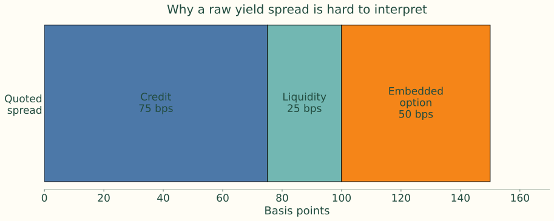{.figure}


## Static spread uses every spot rate

$$
P=\sum_t\frac{CF_t}{(1+r_t+s)^t}
$$

<div class="flow"><span><b>Spot curve</b>Match each payment date</span><i>→</i><span><b>One spread</b>Add the same s at every date</span><i>→</i><span><b>Promised payments</b>Cash flows remain fixed</span></div>

## A constant spread shifts the spot curve

Add the same 80 bp to the spot rate at every maturity.

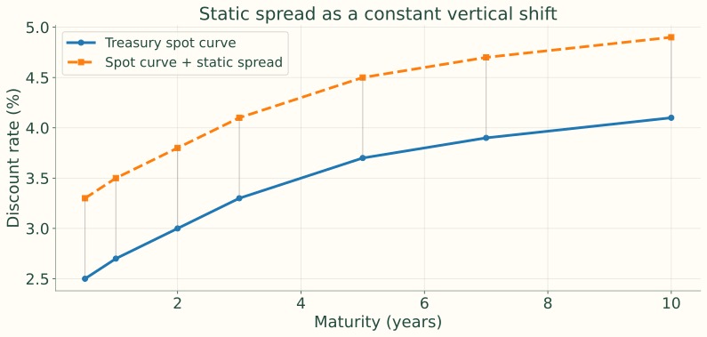{.figure}


## Static-spread example: set up the payments

<div class="comparison"><div><h3>Bond</h3><p>5 years; face $1,000; 6% annual coupon paid semiannually.</p></div><div><h3>Market</h3><p>Price $1,020; ten dated spot rates, from 2.0% to 4.3%.</p></div></div>

<div class="cash-timeline" data-times='["0", "0.5", "1", "\u2026", "4.5", "5"]' data-flows='["\u2212$1,020", "$30", "$30", "\u2026", "$30", "$1,030"]'></div>

Each half-year coupon is $1000(0.06)/2=30$; the final payment is $1000+30=1030$.

## Keep the discount convention consistent

| Time (years) | .5 | 1 | 1.5 | 2 | 2.5 |
|---|---:|---:|---:|---:|---:|
| Spot rate | 2.0% | 2.2% | 2.6% | 3.0% | 3.4% |

| Time (years) | 3 | 3.5 | 4 | 4.5 | 5 |
|---|---:|---:|---:|---:|---:|
| Spot rate | 3.8% | 4.0% | 4.1% | 4.2% | 4.3% |

Use **effective annual** spot rates. Payment $k$ arrives at $t_k=k/2$ years; use that time in the discount exponent.

## Solve for the spread, rather than averaging yields

$$
1020=\sum_{k=1}^{9}\frac{30}{(1+r_{k/2}+s)^{k/2}}+\frac{1030}{(1+0.043+s)^5}
$$

$$
s=0.01400712\approx140.07\text{ bp}
$$

Add $s=1.400712\%$ to each annual spot rate. The payments then have a present value of \$1,020. In basis points, $0.01400712\times10{,}000=140.07$.

## Price is nonlinear in the static spread

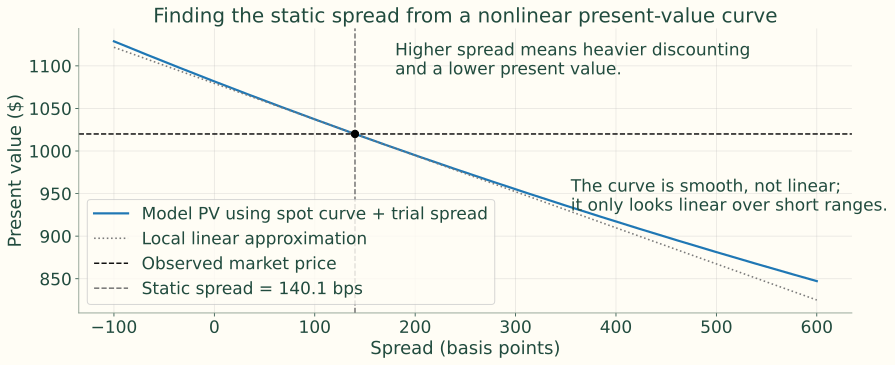{.figure}

Find the spread where the present-value curve crosses the market price of \$1,020.

## The issuer calls when refinancing becomes attractive

<div class="flow"><span><b>Rates fall</b>The old coupon is expensive</span><i>→</i><span><b>Issuer refinances</b>Redeem at the call price</span><i>→</i><span><b>Investor loses upside</b>Above-market coupons disappear</span></div>

When rates fall, the issuer can replace expensive debt with cheaper debt.

## Callability matters most in low-rate states

At a call date with a total payment of 100, compare the cost of continuing with 100. The issuer chooses the cheaper alternative.

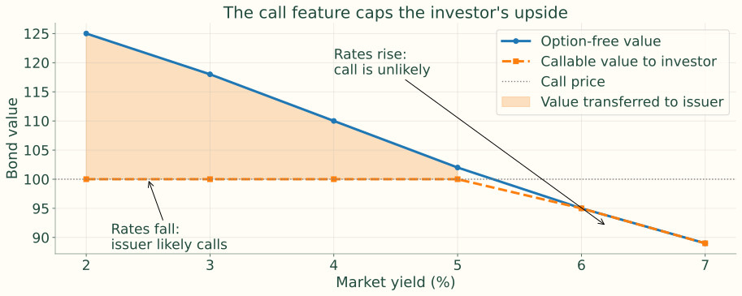{.figure}


## The option has a price

$$
V_{\mathrm{callable}}=V_{\mathrm{straight}}-V_{\mathrm{call}}
$$

<div class="comparison"><div><h3>High yields</h3><p>Call unlikely; the bond behaves more like an option-free bond.</p></div><div><h3>Low yields</h3><p>Exercise becomes attractive; price appreciation slows and effective maturity shortens.</p></div></div>

## Yield to worst is a reporting convention

$$
YTW=\min\{YTM,\ YTC_1,\ YTC_2,\ldots\}
$$

Use the relevant permitted call dates. The minimum yield does not model the probability of exercise, future volatility or the full term structure.

## Separate the bond from the embedded option

$$
V_{\mathrm{callable}}=V_{\mathrm{straight}}-V_{\mathrm{call}}
$$

$$
V_{\mathrm{putable}}=V_{\mathrm{straight}}+V_{\mathrm{put}}
$$

The issuer owns the call; the investor owns the put.

## The call option explains the missing upside

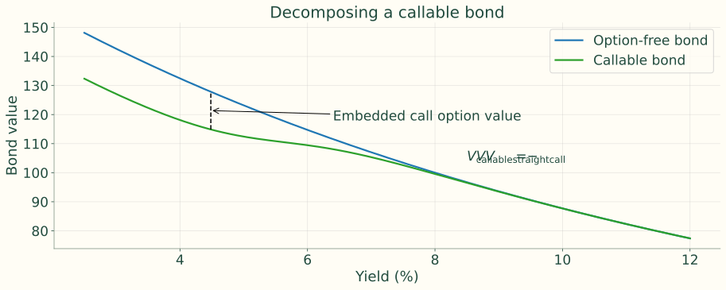{.figure}

The gap between the two bond values is the value of the issuer’s call. Use this sketch to see why the investor gives up upside.

## Value the final payoff, then work backward

<div class="flow"><span><b>Rate states</b>Construct future short rates</span><i>→</i><span><b>Maturity</b>Set terminal cash flows</span><i>→</i><span><b>Rollback</b>Discount risk-neutral continuation</span><i>→</i><span><b>Exercise</b>Apply the contract at each node</span></div>

## Time and rate states in a lattice

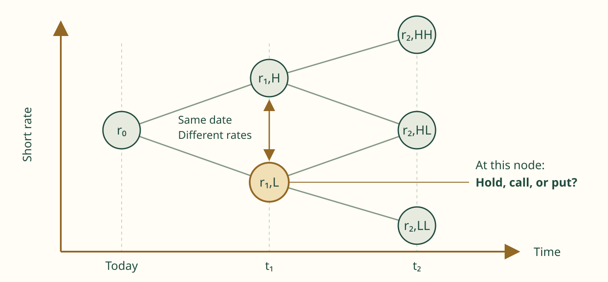{.figure}

Read across for later dates. At one date, move up or down to compare rate states. At each node, decide whether the bond continues or the option is exercised.

## Backward induction reverses the direction of time

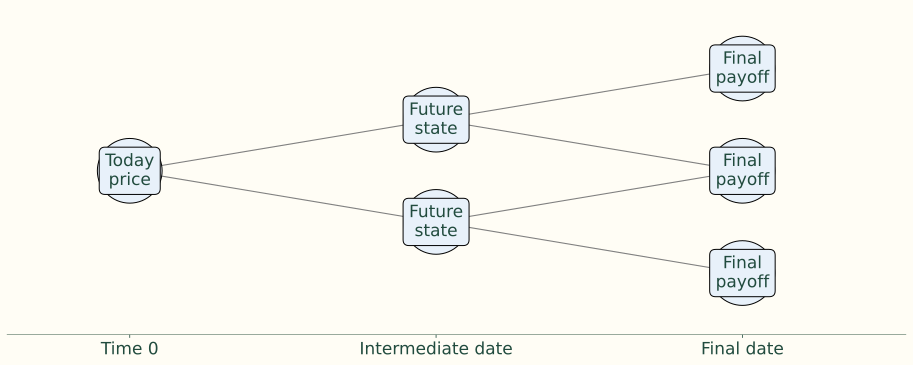{.figure}

Start at maturity. Apply exercise where permitted, then discount the resulting values back one date.

## Three-year example: contract and assumptions

Consider this annual-pay bond:

| Contract | Rate model |
|---|---|
| Face value 100; annual coupon 8; maturity 3 years | Annual steps; risk-neutral up probability $p=0.5$ |
| First call date: year 2 | Initial short rate: 6% |
| Call at par: principal 100 + coupon 8 = total payment 108 | Year-1 rates: 5% and 9%; year-2 rates: 4%, 8%, and 12% |

We value the bond just before the current coupon. A call at year 2 pays principal 100 plus coupon 8. If the bond reaches year 3, maturity also pays 100 plus 8. Subtract the immediate coupon of 8 to get the ex-coupon purchase price at time zero.

## The short-rate lattice

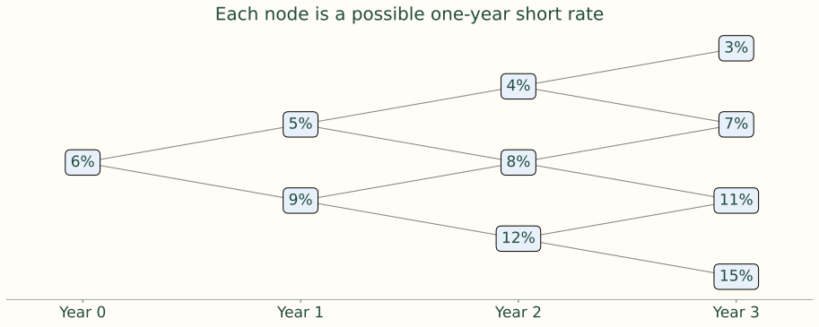{.figure}

Trace the two possible moves from each node. At year 3, the bond pays 108 in every state.

## Backward induction includes the current coupon

$$
H_{i,j}=\frac{pV_{i+1,j+1}+(1-p)V_{i+1,j}}{1+r_{i,j}}+CF_i
$$

Use $p$ for the risk-neutral up probability, $r_{i,j}$ for the node’s one-period short rate, and $CF_i$ for the current coupon.

Discount the two next-period values, then add the current coupon once.

## Exercise replaces continuation value

$$
V^{\mathrm{callable}}_{i,j}=\min\{H_{i,j},K_i\}
$$

$$
V^{\mathrm{putable}}_{i,j}=\max\{H_{i,j},K_i^{\mathrm{put}}\}
$$

Compare the hold value and the exercise payment on the same coupon-inclusive basis. Apply the rule only when the contract allows exercise.

## Choose the exercise action at each node

| Contract | Compare the hold value $H$ with the total exercise payment $K$ | Node value |
|---|---|---|
| Callable | If $H>K$, the issuer calls; otherwise, the bond continues | $\min(H,K)$ |
| Putable | If $H<K$, the investor puts; otherwise, the bond continues | $\max(H,K)$ |

Check the contract’s exercise dates before applying either rule. On other dates, keep the hold value.

## Step 1 — set the terminal payoff {.rollback}

<div class="rollback-step">Year 3: start at maturity · gold nodes = values set now</div>

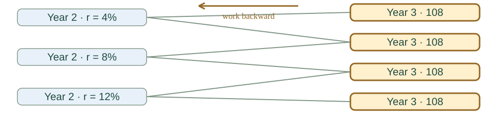{.rollback-figure}

$$V_{3,j}=100+8=108\qquad\text{in every state}$$

Both bonds pay principal **100** plus coupon **8** at maturity. Set these final values before moving one year to the left.

## Step 2 — roll back to year 2 {.rollback}

<div class="rollback-step">Year 3 → year 2 · gold nodes = hold values calculated now</div>

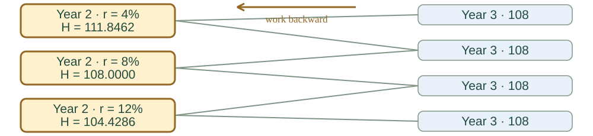{.rollback-figure}

$$H_{2,j}=\frac{0.5(108)+0.5(108)}{1+r_{2,j}}+8$$

| Year-2 rate | Discounted next payment | Coupon now | Hold value |
|---|---:|---:|---:|
| 4% | 103.8462 | 8 | 111.8462 |
| 8% | 100.0000 | 8 | 108.0000 |
| 12% | 96.4286 | 8 | 104.4286 |

## Step 3 — apply the year-2 call right {.rollback}

<div class="rollback-step">Stay at year 2 · compare each hold value with the total call payment 108</div>

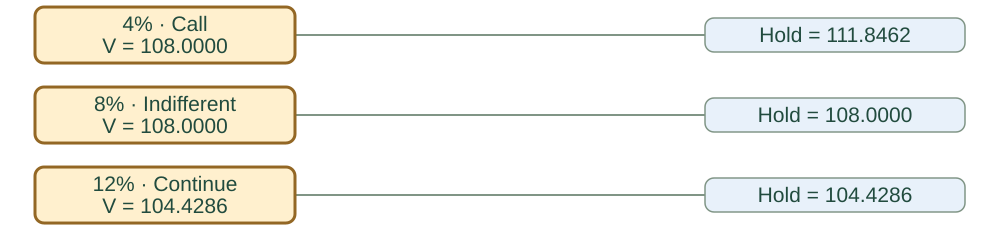{.rollback-figure}

$$V_{2,j}^{c}=\min(H_{2,j},108),\qquad108=100\text{ principal}+8\text{ coupon}$$

| Rate | Hold value | Callable value | Issuer’s decision |
|---|---:|---:|---|
| 4% | 111.8462 | 108.0000 | Call |
| 8% | 108.0000 | 108.0000 | Indifferent |
| 12% | 104.4286 | 104.4286 | Continue |

## Step 4 — year 1, option-free bond {.rollback}

<div class="rollback-step">Year 2 → year 1 · use the full hold values, without a call cap</div>

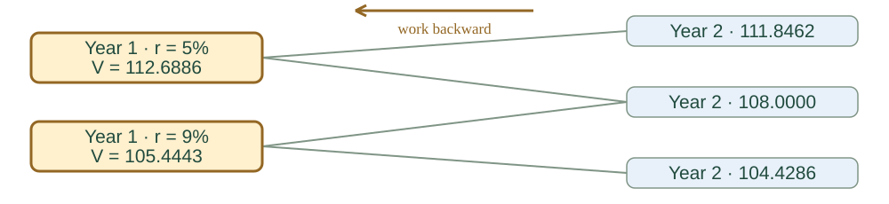{.rollback-figure}

$$V_{1,L}^{s}=\frac{0.5(111.8462)+0.5(108)}{1.05}+8=112.6886$$

$$V_{1,H}^{s}=\frac{0.5(108)+0.5(104.4286)}{1.09}+8=105.4443$$

Average the two connected year-2 values, discount at the highlighted node’s rate, then add its coupon.

## Step 5 — year 1, callable bond {.rollback}

<div class="rollback-step">Year 2 → year 1 · carry back the values after the call decision</div>

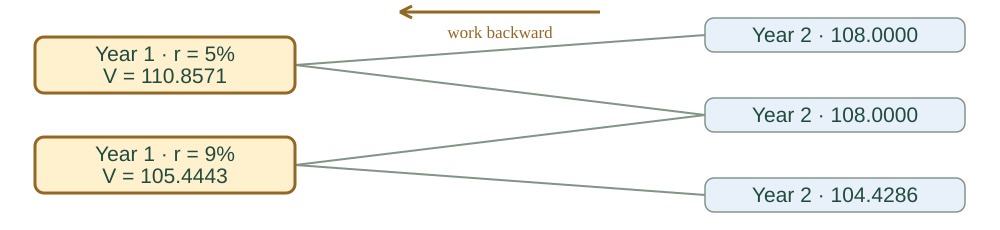{.rollback-figure}

$$V_{1,L}^{c}=\frac{0.5(108)+0.5(108)}{1.05}+8=110.8571$$

$$V_{1,H}^{c}=\frac{0.5(108)+0.5(104.4286)}{1.09}+8=105.4443$$

There is no call at year 1. The low-rate value is smaller because the issuer can call in the following year.

## Step 6 — return to time zero {.rollback}

<div class="rollback-step">Year 1 → today · gold node = today’s values</div>

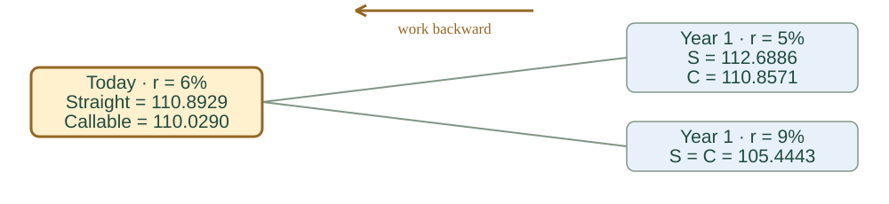{.rollback-figure}

$$V_0^{s}=\frac{0.5(112.6886)+0.5(105.4443)}{1.06}+8\approx110.8929$$

$$V_0^{c}=\frac{0.5(110.8571)+0.5(105.4443)}{1.06}+8=110.0290$$

These include the immediate coupon of 8. Ex-coupon prices are **102.8929** (straight) and **102.0290** (callable).

## Step 7 — identify the embedded call value

$$
V_{\mathrm{call}}=V_{\mathrm{straight}}-V_{\mathrm{callable}}\approx0.86
$$

<div class="comparison"><div><h3>Straight bond</h3><p>110.89 including the current coupon.</p></div><div><h3>Callable bond</h3><p>110.03; the issuer’s call costs the investor about 0.86 per 100 face.</p></div></div>

## Put example — contract and rate lattice {.rollback}

<div class="rollback-step">Set up the problem before valuing any nodes</div>

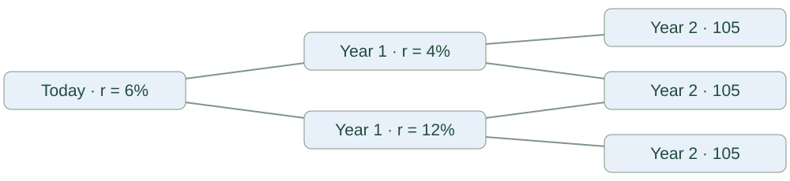{.rollback-figure}

**Bond:** 2 years; face 100; annual coupon 5; maturity payment 105.

**Put:** at year 1, the holder may take a total payment of 100 instead of keeping the bond. This is the complete exercise receipt in this example.

Use annual steps and risk-neutral probability **0.5 on each branch**. Node values include the coupon due at that date.

## Put example — start with the final payment {.rollback}

<div class="rollback-step">Year 2: set the terminal values · gold nodes = values set now</div>

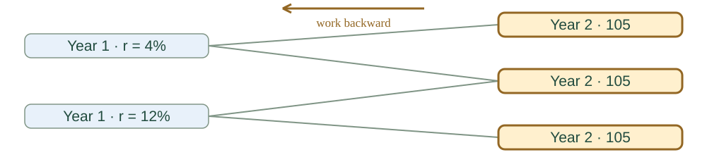{.rollback-figure}

$$V_{2,j}=100+5=105\qquad\text{in every state}$$

**Inputs:** 2 years; face 100; annual coupon 5; today’s rate 6%; year-1 rates 4% and 12%; risk-neutral probability 0.5 on each branch.

The year-1 put receipt is **100 total** in this example. Compare it with a hold value that includes the year-1 coupon; do not add another coupon on exercise.

## Put example — calculate the year-1 hold values {.rollback}

<div class="rollback-step">Year 2 → year 1 · gold nodes = continuation values before exercise</div>

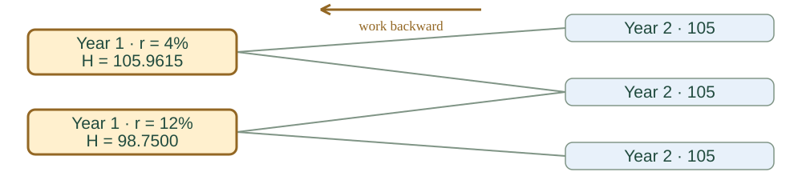{.rollback-figure}

$$H_{1,j}=\frac{0.5(105)+0.5(105)}{1+r_{1,j}}+5$$

| Year-1 rate | Discount next payment | Add current coupon | Hold value |
|---|---:|---:|---:|
| 4% | $105/1.04=100.9615$ | 5 | 105.9615 |
| 12% | $105/1.12=93.7500$ | 5 | 98.7500 |

## Put example — let the holder choose {.rollback}

<div class="rollback-step">Stay at year 1 · gold nodes = values after the put decision</div>

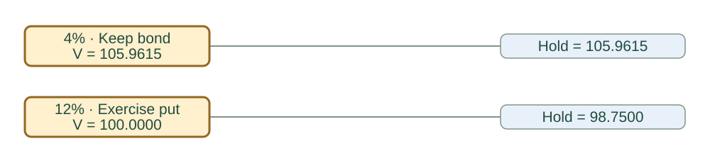{.rollback-figure}

$$V_{1,j}^{\mathrm{put}}=\max(H_{1,j},100)$$

| Year-1 rate | Hold value | Total put receipt | Holder’s choice | Value |
|---|---:|---:|---|---:|
| 4% | 105.9615 | 100 | Keep bond | 105.9615 |
| 12% | 98.7500 | 100 | Exercise put | 100.0000 |

At 12%, the holder takes 100 instead of keeping a bond worth 98.75.

## Put example — bring the protected values to today {.rollback}

<div class="rollback-step">Year 1 → today · gold node = today’s putable value</div>

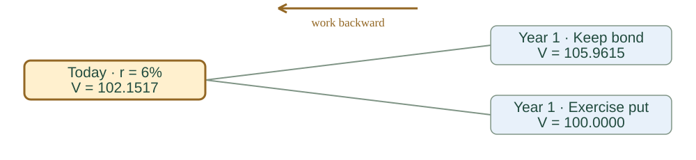{.rollback-figure}

$$V_0^{\mathrm{put}}=\frac{0.5(105.9615)+0.5(100)}{1.06}+5=102.1517$$

Use the year-1 values **after** the holder’s decision. Discount their average at 6%, then add today’s coupon of 5.

The value is **102.1517** including the immediate coupon; the ex-coupon price is **97.1517**.

## A valuation tree must fit observed prices

<div class="flow"><span><b>Inputs</b>Initial curve, model, volatility, time step</span><i>→</i><span><b>Trial rates</b>Choose the lower rate and node spacing</span><i>→</i><span><b>Benchmark price</b>Roll back the next maturity</span><i>→</i><span><b>Calibration</b>Adjust the level and repeat</span></div>

Before pricing an option, check that your tree reproduces the benchmark bond prices.

## Volatility controls spacing; calibration controls level

Take annual steps, volatility $\sigma=10\%$, and a trial lower rate $r_{1,L}=4.074\%$.

$$
u=e^{\sigma\sqrt{\Delta t}},\qquad d=u^{-1}
$$

$$
r_{1,H}=r_{1,L}e^{2\sigma}=4.074\%\,e^{0.20}\approx4.976\%
$$

Adjust the rate level until the tree matches the two-year benchmark price. Then extend the tree to the next maturity.

## Four maturities require four level parameters

Fit a tree to this annual zero curve:

| Maturity | Zero rate | Market discount factor |
| -------: | --------: | ---------------------: |
| 1 year | 4.00% | 0.96154 |
| 2 years | 4.50% | 0.91573 |
| 3 years | 5.00% | 0.86384 |
| 4 years | 5.25% | 0.81491 |

$$r_{t,j}=a_t e^{(2j-t)\sigma}.$$

Use one level $a_t$ per date to fit $P(0,T)=(1+z_T)^{-T}$. Keep $p=0.5$, annual steps, and $\sigma=10\%$.

## Calibrated node rates reproduce the zero prices

| Maturity | Market DF | Calibrated level $a_t$ | Short rates at that date | Tree DF |
|---|---|---|---|---|
| 1 year | 0.96154 | 4.00% | 4.00% | 0.96154 |
| 2 years | 0.91573 | 4.98% | 4.51%, 5.50% | 0.91573 |
| 3 years | 0.86384 | 5.96% | 4.88%, 5.96%, 7.28% | 0.86384 |
| 4 years | 0.81491 | 5.93% | 4.40%, 5.37%, 6.56%, 8.01% | 0.81491 |

Check the last column against the market discount factors. The levels make the prices match; volatility controls the spacing between rates.

## Credit can enter the valuation in different ways

<div class="comparison"><div><h3>Spread approach</h3><p>Add s to each short rate: rᵣᵢₛₖᵧ = r + s.</p></div><div><h3>Explicit default</h3><p>Model survival, default probabilities and recovery cash flows.</p></div></div>

Choose how to include credit risk. If the issuer curve already includes it, do not add the same compensation again.

## Implementation: market inputs and contract details

<div class="comparison"><div><h3>Market inputs</h3><p>Fit the benchmark or issuer curve. Choose rate volatility; greater volatility generally raises call value and lowers callable value.</p></div><div><h3>Contract details</h3><p>Model call schedules, prices, notice periods, make-whole terms and exercise restrictions.</p></div></div>

## Implementation: timing and credit treatment

<div class="comparison"><div><h3>Dates</h3><p>Coupon, call and settlement dates may not align with lattice steps. Discount them consistently.</p></div><div><h3>Credit</h3><p>Choose issuer curve, added spread, default/recovery or a justified combination.</p></div></div>

Use the same dates, credit treatment, and exercise terms when you solve OAS and measure risk.

## OAS solves the price after modeling exercise

$$
P_{\mathrm{market}}=P_{\mathrm{model}}(r_{i,j}+s_{\mathrm{OAS}};\ \text{exercise rule})
$$

<div class="comparison"><div><h3>Static spread</h3><p>Full spot curve, but promised cash flows remain fixed.</p></div><div><h3>OAS</h3><p>Future cash flows change by state when the option is exercised.</p></div></div>

## Why option adjustment helps comparison

<div class="flow"><span><b>Yield spread</b>One yield and one benchmark maturity</span><i>→</i><span><b>Static spread</b>Correct cash-flow discount dates</span><i>→</i><span><b>OAS</b>Also model changing cash flows</span></div>

Use static spread for the promised payment schedule. Use OAS when exercise changes that schedule.

## OAS depends on the benchmark

<div class="comparison"><div><h3>Treasury curve</h3><p>Remaining spread can reflect credit, liquidity and model risk.</p></div><div><h3>Issuer curve</h3><p>Remaining spread is closer to relative richness or cheapness versus the issuer.</p></div></div>

Before comparing OAS quotes, check that the benchmark curve, volatility, and exercise assumptions are comparable.

## Solve OAS by repeated valuation

<div class="flow"><span><b>Trial spread</b>Add the same spread at every node</span><i>→</i><span><b>Rollback</b>Reapply exercise throughout the tree</span><i>→</i><span><b>Compare</b>Model price versus market price</span><i>→</i><span><b>Iterate</b>Adjust spread until prices match</span></div>

## Express the option cost in spread terms

Suppose the static spread is 150 bp and the solved OAS is 100 bp.

$$
\text{Option cost}\approx\text{Static spread}-\text{OAS}
$$

$$
150\text{ bp}-100\text{ bp}=50\text{ bp}
$$

Hold the callable bond’s market price fixed. More volatility raises the issuer’s call value, so the OAS needed to match that price generally falls.

## Effective risk allows the cash flows to change

<div class="flow"><span><b>Base curve</b>Price P₀</span><i>→</i><span><b>Downward shift</b>Reprice to obtain P₋</span><i>→</i><span><b>Upward shift</b>Reprice to obtain P₊</span></div>

Shift the curve, rebuild the tree, and reprice with the same OAS. Check exercise again after each shift.

## Effective duration measures the central slope

$$
D_e=\frac{P_- - P_+}{2P_0\Delta y}
$$

Enter $\Delta y$ as a decimal. A 50 bp shock is $0.005$.

## Effective convexity measures the asymmetry

$$
C_e=\frac{P_-+P_+-2P_0}{P_0(\Delta y)^2}
$$

Compare the gain when rates fall with the loss when rates rise. A call can cap the gain and make effective convexity negative.

## The same curve shock produces different price responses

For this example, use $P_-=103.5$, $P_0=102$, and $P_+=98.5$ after $-50$, $0$, and $+50$ bp curve shifts.

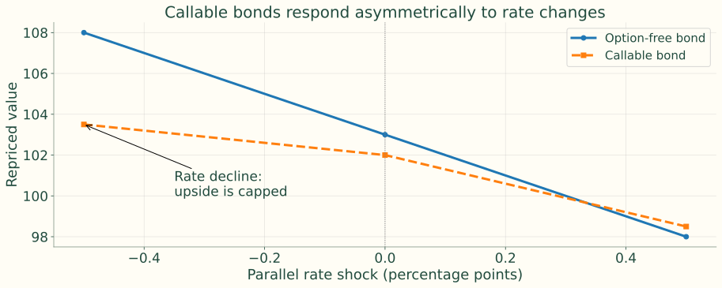{.figure}


## Apply the effective-risk formulas to the illustration

$$
D_e=\frac{103.5-98.5}{2(102)(0.005)}=4.902
$$

$$
C_e=\frac{103.5+98.5-2(102)}{102(0.005)^2}=-784.31
$$

The loss from a rate rise exceeds the gain from an equal rate fall. That asymmetry gives negative convexity in this example.

## Interactive four-period example: assumptions

```{=html}
<div id="lec8-lattice-tool" style="font-size:24px; padding: .6em; background: #f8f9fa; border-radius: 6px; margin: .2em 0;">
  <div style="display: grid; grid-template-columns: repeat(3, 1fr); gap: 0.75em; align-items: end;">
    <label><strong>Face value</strong><br>
      <input type="number" id="lec8-face" value="100" min="1" step="1" style="width: 100%; font-size:26px; height:36px;">
    </label>
    <label><strong>Coupon rate (%)</strong><br>
      <input type="number" id="lec8-coupon-rate" value="6" min="0" step="0.25" style="width: 100%; font-size:26px; height:36px;">
    </label>
    <label><strong>Current short rate (%)</strong><br>
      <input type="number" id="lec8-r0" value="5" min="0" step="0.25" style="width: 100%; font-size:26px; height:36px;">
    </label>
    <label><strong>Volatility (%)</strong><br>
      <input type="number" id="lec8-sigma" value="12" min="0" step="1" style="width: 100%; font-size:26px; height:36px;">
    </label>
    <label><strong>Option type</strong><br>
      <select id="lec8-option-type" style="width: 100%; font-size:26px; height:36px;">
        <option value="call">Callable</option>
        <option value="put">Putable</option>
        <option value="none">Option-free</option>
      </select>
    </label>
    <label><strong>Option price</strong><br>
      <input type="number" id="lec8-option-price" value="100" min="0" step="0.25" style="width: 100%; font-size:26px; height:36px;">
    </label>
    <label><strong>First exercise period</strong><br>
      <input type="number" id="lec8-exercise-from" value="2" min="1" max="3" step="1" style="width: 100%; font-size:26px; height:36px;">
    </label>
    <label><strong>Market price</strong><br>
      <input type="number" id="lec8-market-price" value="102" min="1" step="0.25" style="width: 100%; font-size:26px; height:36px;">
    </label>
    <label><strong>Rate shock (bp)</strong><br>
      <input type="number" id="lec8-shock-bp" value="50" min="1" step="1" style="width: 100%; font-size:26px; height:36px;">
    </label>
  </div>

  <div id="lec8-lattice-results" style="display: grid; grid-template-columns: repeat(auto-fit, minmax(150px, 1fr)); gap: 0.6em; margin-top: 1em;"></div>
</div>
```

Change one input and follow its effect on price, OAS, and risk. This tree includes an immediate coupon and is not fitted to a market curve.


```{=html}
<script>
function lec8FormatPct(x) {
  return (100 * x).toFixed(2) + "%";
}

function lec8BuildTree(r0, sigma, n, shift) {
  const tree = [];
  for (let i = 0; i <= n; i++) {
    const level = [];
    for (let j = 0; j <= i; j++) {
      level.push(Math.max(-0.95, r0 * Math.exp((2 * j - i) * sigma) + shift));
    }
    tree.push(level);
  }
  return tree;
}

function lec8PriceTree(rateTree, params, spread) {
  const n = 4;
  const p = 0.5;
  const coupon = params.face * params.couponRate;
  let values = Array(n + 1).fill(params.face + coupon);
  const levels = [values.slice()];

  for (let i = n - 1; i >= 0; i--) {
    const next = [];
    for (let j = 0; j <= i; j++) {
      const r = rateTree[i][j] + spread;
      let hold = (p * values[j + 1] + (1 - p) * values[j]) / (1 + r) + coupon;
      if (params.optionType === "call" && i >= params.exerciseFrom && i < n) {
        hold = Math.min(hold, params.optionPrice);
      } else if (params.optionType === "put" && i >= params.exerciseFrom && i < n) {
        hold = Math.max(hold, params.optionPrice);
      }
      next.push(hold);
    }
    values = next;
    levels.unshift(values.slice());
  }

  return { price: values[0], levels: levels };
}

function lec8SolveOas(rateTree, params) {
  let lo = -0.20;
  let hi = 0.20;
  const priceAt = s => lec8PriceTree(rateTree, params, s).price;
  let priceLo = priceAt(lo);
  let priceHi = priceAt(hi);

  if (!Number.isFinite(priceLo) || !Number.isFinite(priceHi) || params.marketPrice > priceLo || params.marketPrice < priceHi) {
    return NaN;
  }

  for (let k = 0; k < 80; k++) {
    const mid = 0.5 * (lo + hi);
    const priceMid = priceAt(mid);
    if (priceMid > params.marketPrice) {
      lo = mid;
    } else {
      hi = mid;
    }
  }
  return 0.5 * (lo + hi);
}

function lec8DrawSvg(rateTree, valueLevels, params, oas) {
  const width = 900;
  const height = 530;
  const marginX = 80;
  const midY = 255;
  const stepX = 180;
  const stepY = 90;
  const n = 4;
  const positions = [];

  for (let i = 0; i <= n; i++) {
    positions[i] = [];
    for (let j = 0; j <= i; j++) {
      positions[i][j] = {
        x: marginX + i * stepX,
        y: midY + (i - 2 * j) * stepY / 2
      };
    }
  }

  let svg = `<svg viewBox="0 0 ${width} ${height}" width="100%" height="530" role="img" aria-label="Four-period interest-rate lattice">`;
  svg += `<rect x="0" y="0" width="${width}" height="${height}" fill="white"></rect>`;

  for (let i = 0; i < n; i++) {
    for (let j = 0; j <= i; j++) {
      const a = positions[i][j];
      const b = positions[i + 1][j];
      const c = positions[i + 1][j + 1];
      svg += `<line x1="${a.x}" y1="${a.y}" x2="${b.x}" y2="${b.y}" stroke="#888" stroke-width="1.4"></line>`;
      svg += `<line x1="${a.x}" y1="${a.y}" x2="${c.x}" y2="${c.y}" stroke="#888" stroke-width="1.4"></line>`;
    }
  }

  for (let i = 0; i <= n; i++) {
    svg += `<text x="${marginX + i * stepX}" y="510" text-anchor="middle" font-size="18">T${i}</text>`;
    for (let j = 0; j <= i; j++) {
      const pos = positions[i][j];
      const rate = lec8FormatPct(rateTree[i][j]);
      const value = valueLevels[i] && valueLevels[i][j] !== undefined ? valueLevels[i][j].toFixed(2) : "";
      svg += `<circle cx="${pos.x}" cy="${pos.y}" r="39" fill="#E8F1FA" stroke="black" stroke-width="1.6"></circle>`;
      svg += `<text x="${pos.x}" y="${pos.y - 8}" text-anchor="middle" font-size="17">r=${rate}</text>`;
      svg += `<text x="${pos.x}" y="${pos.y + 10}" text-anchor="middle" font-size="17">V=${value}</text>`;
    }
  }

  svg += `<text x="20" y="25" font-size="18">Maturity fixed at 4 periods; p = 0.5; OAS = ${Number.isFinite(oas) ? (10000 * oas).toFixed(1) + " bp" : "not bracketed"}</text>`;
  svg += `</svg>`;
  return svg;
}

function lec8UpdateLatticeTool() {
  const params = {
    face: parseFloat(document.getElementById("lec8-face").value),
    couponRate: parseFloat(document.getElementById("lec8-coupon-rate").value) / 100,
    r0: parseFloat(document.getElementById("lec8-r0").value) / 100,
    sigma: parseFloat(document.getElementById("lec8-sigma").value) / 100,
    optionType: document.getElementById("lec8-option-type").value,
    optionPrice: parseFloat(document.getElementById("lec8-option-price").value),
    exerciseFrom: parseInt(document.getElementById("lec8-exercise-from").value, 10),
    marketPrice: parseFloat(document.getElementById("lec8-market-price").value),
    shock: parseFloat(document.getElementById("lec8-shock-bp").value) / 10000
  };

  const rateTree = lec8BuildTree(params.r0, params.sigma, 4, 0);
  const base = lec8PriceTree(rateTree, params, 0);
  const oas = lec8SolveOas(rateTree, params);

  let duration = NaN;
  let convexity = NaN;
  let valueLevels = base.levels;

  if (Number.isFinite(oas)) {
    valueLevels = lec8PriceTree(rateTree, params, oas).levels;
    const upTree = lec8BuildTree(params.r0, params.sigma, 4, params.shock);
    const downTree = lec8BuildTree(params.r0, params.sigma, 4, -params.shock);
    const p0 = lec8PriceTree(rateTree, params, oas).price;
    const pUp = lec8PriceTree(upTree, params, oas).price;
    const pDown = lec8PriceTree(downTree, params, oas).price;
    duration = (pDown - pUp) / (2 * p0 * params.shock);
    convexity = (pDown + pUp - 2 * p0) / (p0 * params.shock * params.shock);
  }

  const resultItems = [
    ["Model price", base.price.toFixed(3)],
    ["OAS", Number.isFinite(oas) ? (10000 * oas).toFixed(1) + " bp" : "not bracketed"],
    ["Effective duration", Number.isFinite(duration) ? duration.toFixed(3) : "n/a"],
    ["Effective convexity", Number.isFinite(convexity) ? convexity.toFixed(2) : "n/a"]
  ];

  document.getElementById("lec8-lattice-results").innerHTML = resultItems.map(item =>
    `<div style="background: white; border: 1px solid #ddd; border-radius: 6px; padding: 0.65em;"><div style="font-size: 0.85em; color: #555;">${item[0]}</div><div style="font-size: 1.15em; font-weight: 700;">${item[1]}</div></div>`
  ).join("");

  document.getElementById("lec8-lattice-svg").innerHTML = lec8DrawSvg(rateTree, valueLevels, params, oas);
}

function lec8InitLatticeTool() {
  const tool = document.getElementById("lec8-lattice-tool");
  if (!tool || tool.dataset.initialized === "true") return;
  tool.dataset.initialized = "true";

  document.querySelectorAll("#lec8-lattice-tool input, #lec8-lattice-tool select").forEach(el => {
    el.addEventListener("input", lec8UpdateLatticeTool);
    el.addEventListener("change", lec8UpdateLatticeTool);
  });
  lec8UpdateLatticeTool();
}

if (document.readyState === "loading") {
  document.addEventListener("DOMContentLoaded", lec8InitLatticeTool);
} else {
  lec8InitLatticeTool();
}
</script>

```

## Interactive four-period example: inspect the nodes

<div id="lec8-lattice-svg" style="height:540px"></div>

Use the previous slide’s inputs. Read the short rate and bond value at each node; check where the call or put changes the value.

## Keep the valuation logic intact

<div class="flow"><span><b>Options</b>Change future cash flows</span><i>→</i><span><b>Lattice</b>Prices state-dependent exercise</span><i>→</i><span><b>Calibration</b>Anchors rates to the market</span><i>→</i><span><b>OAS and risk</b>Remain model dependent</span></div>

For a call, take the minimum; for a put, take the maximum. On dates without an exercise right, discount the continuation value.
