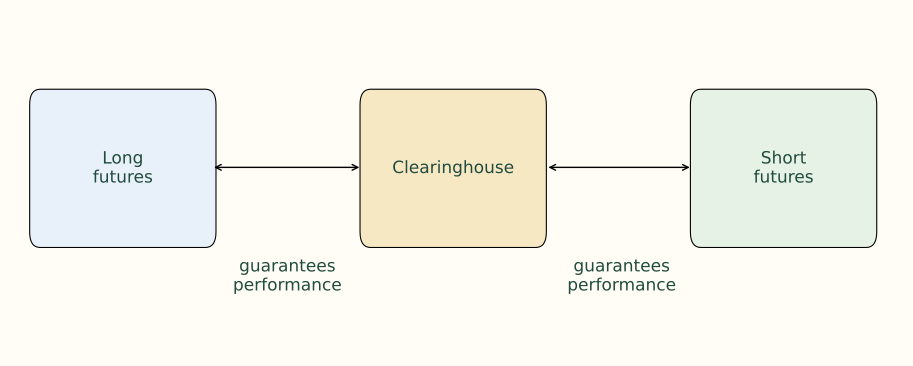
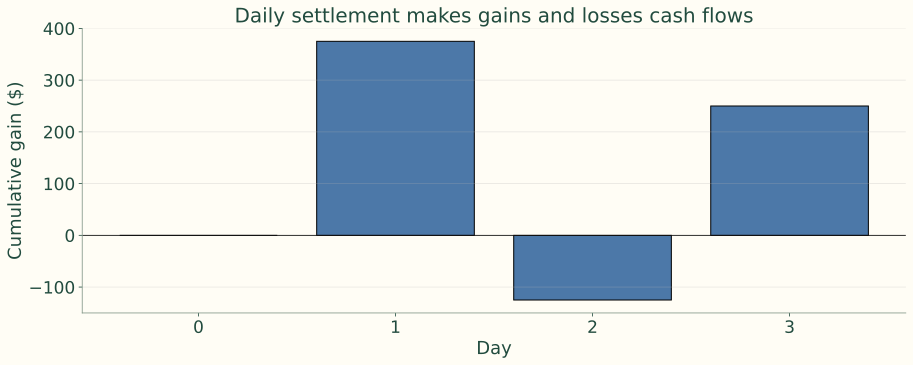
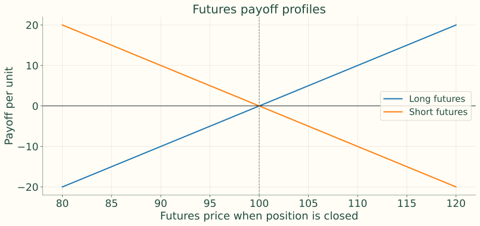
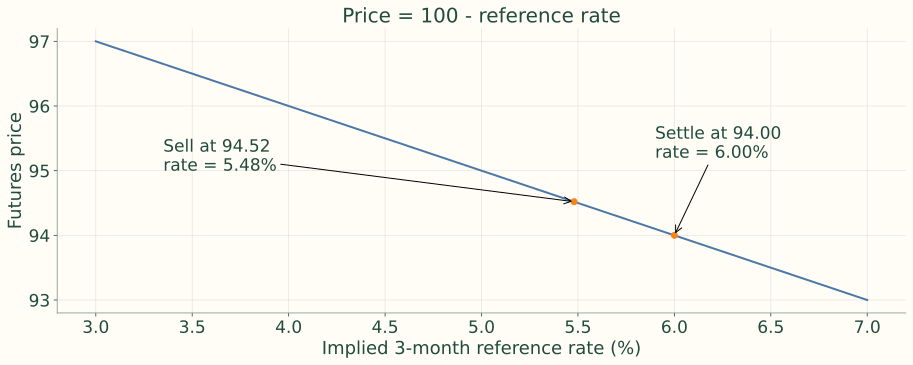
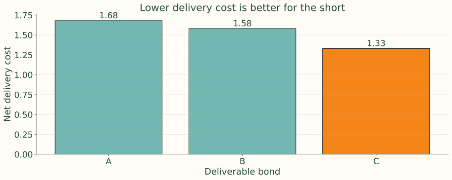
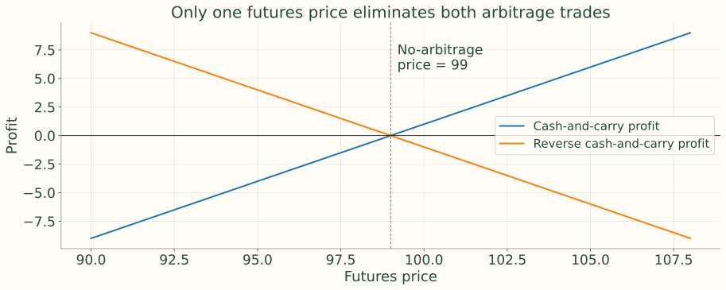
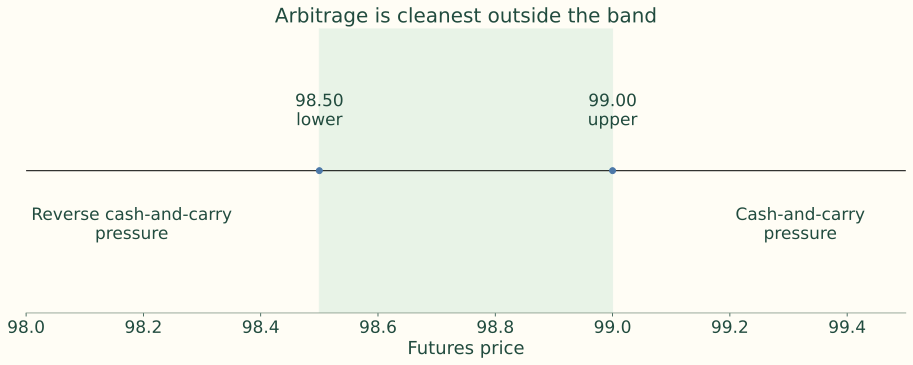
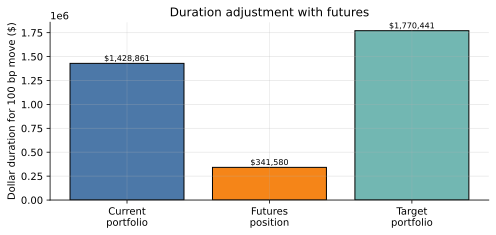
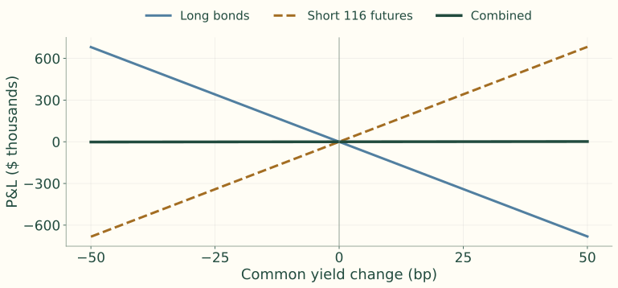

## Futures separate rate exposure from cash ownership

A futures contract fixes a price today for settlement or delivery at a specified future date. Exchange rules define the contract, and a clearinghouse stands between buyer and seller.

| Position | Opening trade | Profitable price move | Treasury-rate exposure |
|---|---|---|---|
| Long futures | Buy | Futures price rises | Usually benefits from falling rates |
| Short futures | Sell | Futures price falls | Usually benefits from rising rates |

The nearby contract is closest to settlement. Many financial futures use March, June, September and December cycles.

**Portfolio use:** change interest-rate exposure without immediately buying or selling cash bonds.

## Clearing and closing a futures position {.worked}

::: {.columns}
::: {.column width="52%"}
{.figure}

The clearinghouse becomes the buyer to every seller and the seller to every buyer. Margining reduces counterparty risk, but does not eliminate all financial-system risk.
:::
::: {.column width="48%"}
### Closing before delivery

- Sell the same contract to close a long position.
- Buy the same contract to close a short position.
- The original counterparty need not participate.

### Holding through settlement

Physical-delivery contracts exchange an eligible security. Cash-settled contracts exchange the final cash amount. Most positions close before delivery.
:::
:::

## Notional exposure and leverage

| Contract illustration | Exposure scale | Dollar sensitivity |
|---|---|---|
| Treasury futures | $100,000 par | One full quote point = $1,000 |
| Three-month rate futures | $1 million over a quarter | One basis point = $25 |

$$
1{,}000{,}000(0.0001)\frac{90}{360}=\$25
$$

With $100,000 of exposure and $5,000 initial margin, exposure is **20 times** posted collateral. A 1% adverse move produces a $1,000 loss, or 20% of that margin.

Margin is performance collateral, not the purchase price or a securities-margin loan.

## Daily settlement and margin requirements

<b>Open</b>Post initial margin<i>→</i><b>Settle</b>Exchange sets the daily price<i>→</i><b>Transfer cash</b>Credit gains or debit losses<i>→</i><b>Fund</b>Restore required collateral

| Term | Meaning |
|---|---|
| Initial margin | Collateral needed to open the position |
| Maintenance margin | Minimum account balance before a top-up |
| Variation margin | Daily transfer of marked-to-market gains and losses |
| Margin call | Request to restore collateral under the account's rules |

A profitable hedge can still create cash demands before the cash-bond position is sold.

## Treasury marking to market: daily and total gain {.worked}

Long one $100,000 Treasury contract at 100-00. One quote point = $1,000; one 32nd = $31.25.

::: {.columns}
::: {.column width="55%"}
| Day | Settlement | Change | Long cash flow |
|---:|---:|---:|---:|
| 0 | 100-00 | — | — |
| 1 | 100-12 | +12/32 | +$375 |
| 2 | 99-28 | −16/32 | −$500 |
| 3 | 100-08 | +12/32 | +$375 |

$$
\text{Total}=375-500+375=\$250
$$
:::
::: {.column width="45%"}
{.figure}

Final quote: $100\text{-}08=100.25$.

$$
(100.25-100.00)(1000)=\$250
$$
:::
:::

The sum of daily cash flows equals the entry-to-exit gain, before funding and reinvestment effects.

## Futures versus forwards

| Feature | Futures | Forwards |
|---|---|---|
| Trading and terms | Exchange; standardized | Over the counter; negotiated |
| Counterparty exposure | Managed through clearing | Direct exposure to counterparty |
| Marking to market | Daily | Depends on contract terms |
| Exit | Offset in the market | Often less liquid or negotiated |
| Settlement | Usually offset before delivery | Often intended for delivery |

Standardization and clearing support liquidity. Customization lets a forward match a particular cash flow, but changes credit and exit arrangements.

## Long and short gains are equal and opposite {.worked}

::: {.columns}
::: {.column width="48%"}
For entry quote $F_0$ and exit quote $F_1$:

$$
\Pi_{long}=(F_1-F_0)M
$$

$$
\Pi_{short}=-(F_1-F_0)M
$$

$M$ is the dollar multiplier per quote point. For one $100,000 Treasury contract, $M=\$1{,}000$.

At $F_0=100$ and $F_1=102$, the long gains $2,000 and the short loses $2,000.
:::
::: {.column width="52%"}
{.figure}

The graph shows quote-point gains for an entry at 100. Multiply by $M$ for dollars. Costs and daily-settlement funding are omitted.
:::
:::

## Interest-rate futures by exposure

| Family | Main exposure | Contract scale or delivery sector |
|---|---|---|
| SOFR / Fed Funds | Short-term reference rates | Cash settlement |
| 2-year Treasury note | Short Treasury sector | $200,000 face |
| 5- / 10-year Treasury note | Intermediate Treasury sectors | $100,000 face |
| Treasury bond | Long Treasury sector | $100,000 face |
| Ultra Treasury bond | Very long Treasury sector | Eligible bonds with at least 25 years remaining at the delivery reference date |

Exact maturity windows, deliverable grades, tick increments and delivery dates depend on the contract specifications.

## Historical Eurodollar futures and the rate-index convention

Eurodollar futures referenced three-month USD LIBOR on $1 million. They are historical examples after the LIBOR transition; today's USD short-rate focus is SOFR and Fed Funds futures.

$$
\text{Index}=100-\text{annualized reference rate (\%)}
$$

At an index of 94.52, the implied rate is $100-94.52=5.48\%$.

$$
0.01\text{ index point}=1\text{ bp},\qquad
1{,}000{,}000(0.0001)\frac{90}{360}=\$25
$$

An index increase means a rate decrease. The $25 sensitivity is **per basis point**; an exchange's minimum tick may be smaller.

## Short-rate hedge: a borrower sells futures {.worked}

Historical Eurodollar example: short one three-month contract; $1 million notional; $25 per basis point.

::: {.columns}
::: {.column width="48%"}
| | Index | Implied rate |
|---|---:|---:|
| Entry | 94.52 | 5.48% |
| Settlement | 94.00 | 6.00% |

$$
94.52-94.00=0.52=52\text{ bp}
$$

$$
\Pi_{short}=52(25)=\$1{,}300
$$

Rates rose, so the short gains. That gain can offset higher future borrowing costs.
:::
::: {.column width="52%"}
{.figure}
:::
:::

## SOFR futures reference secured overnight funding

SOFR measures overnight borrowing collateralized by Treasury securities. Both SOFR contracts settle in cash.

| Contract | Reference-rate calculation |
|---|---|
| One-Month SOFR | Arithmetic average of daily SOFR during the delivery month |
| Three-Month SOFR | Business-day compounded SOFR during the reference quarter |

$$
\text{SOFR futures index}=100-\text{implied SOFR rate (\%)}
$$

The index convention carries over from earlier rate contracts; the underlying rate and settlement calculation differ. Dollar multipliers must match the chosen contract.

## Three-Month SOFR: quotes and cash gains {.worked}

One Three-Month SOFR contract: $1 million notional; $2,500 per index point, or $25 per basis point.

$$
\text{Dollar gain to long}=(F_1-F_0)(2500)
$$

| Long position | Implied rate change | Index change | Dollar gain |
|---|---|---|---:|
| Buy 95.20; settle 95.24 | 4.80% to 4.76% | 0.04 = 4 bp | $4(25)=100$ |
| Buy 95.25; settle 95.40 | 4.75% to 4.60% | 0.15 = 15 bp | $15(25)=375$ |

At a final rate of 5.00%, the index is 95.00 and the quotation unit is $2500(95)=237{,}500$. This is **not** an upfront investment: gains and losses flow through daily settlement.

## Fed Funds futures and policy expectations

$$
F=100-\text{average monthly effective federal funds rate (\%)}
$$

A quote of 95.625 implies $100-95.625=4.375\%$ for the contract month.

| | SOFR | Fed Funds |
|---|---|---|
| Funding market | Treasury-secured overnight borrowing | Unsecured overnight bank funding |
| Main use | Short-rate and derivatives hedging | Exposure to policy-month rate outcomes |

Futures prices reflect market pricing of future rates, not guaranteed forecasts. The reference rate and period must match the exposure being hedged.

## Treasury futures: delivery and conversion factors

<b>Exchange</b>Defines the eligible basket<i>→</i><b>Short</b>Selects a deliverable issue<i>→</i><b>Long</b>Pays the invoice amount

Treasury futures generally settle by physical delivery. Our bond reference has $100,000 par, 20-year maturity and a 6% coupon; actual delivery uses eligible securities.

**Conversion factors** adjust the delivery invoice for different coupons and maturities relative to the contract standard. They do not make all eligible bonds equally attractive to deliver.

## Treasury quotes and delivery invoice {.worked}

::: {.columns}
::: {.column width="47%"}
### Quote units

For $100,000 contract face:

$$
97\text{-}16=97+16/32=97.50
$$

$$
0.9750(100{,}000)=\$97{,}500
$$

One 32nd is $100{,}000/(100\times32)=\$31.25$. Minimum tick sizes vary by contract.
:::
::: {.column width="53%"}
### Invoice example

$Q=\$100{,}000$ face; $F=94\text{-}08=94.25$ per 100 par; $CF=1.20$.

$$
\text{Invoice}=Q\frac{F}{100}CF+AI
$$

$$
=100{,}000(0.9425)(1.20)+AI
$$

$$
=\$113{,}100+AI
$$

$AI$ is dollar accrued interest.
:::
:::

## Repo financing and implied repo

A repo finances a security: sell it for cash today and agree to repurchase it at a higher price. The price difference is the financing cost.

An implied repo rate asks: **what financing rate makes buying a bond and delivering it into futures break even?**

$$
\text{Implied repo}\approx
\frac{\text{delivery invoice}-\text{cash price}}{\text{cash price}}
\frac{360}{\text{days to delivery}}
$$

Use consistent dollar amounts. This simplified expression omits coupons and accrued-interest details. The eligible bond with the highest full implied repo rate is the most attractive to deliver.

## Cheapest-to-deliver example {.worked}

Futures F = 94.00. All amounts are per $100 par. Ignore financing and accrued interest.

$$
\text{Net cost}=\text{Cash price}-F\times CF
$$

::: {.columns}
::: {.column width="58%"}
| Bond | Cash | CF | F × CF | Net cost |
|---|---:|---:|---:|---:|
| A | 103.20 | 1.0800 | 101.52 | 1.68 |
| B | 98.40 | 1.0300 | 96.82 | 1.58 |
| C | 91.10 | 0.9550 | 89.77 | 1.33 |

For C: $91.10-94(0.9550)=1.33$.

**Bond C is cheapest to deliver** in this simplified comparison.
:::
::: {.column width="42%"}
{.figure}
:::
:::

A live comparison also includes financing, coupon income, accrued interest and delivery timing.

## Delivery choices have value to the short

| Choice | Right held by the short |
|---|---|
| Quality / swap | Choose the eligible issue |
| Timing | Choose when to deliver during the permitted period |
| Wild card | Give notice after the daily settlement price is set, under applicable rules |

In a simplified single-deliverable carry model:

$$
F=P[1+t(r-c)]-\text{combined delivery-option value}
$$

These rights reduce futures value to the long. Quality is part of the combined adjustment, so it is not subtracted a second time. Actual Treasury pricing also incorporates conversion factors and the delivery basket.

## Cash-and-carry links cash and futures prices

Equivalent future cash flows should have equivalent values. Financing a cash bond provides a benchmark for its future delivery price.

| If the future is… | Cash-market trade today | Futures trade | At delivery |
|---|---|---|---|
| Too expensive | Borrow and buy the bond | Sell futures | Deliver the bond; repay financing |
| Too cheap | Short the bond and invest proceeds | Buy futures | Acquire the bond; return it to the lender |

Coupon receipts belong to the cash-bond owner. A short seller must compensate the lender for coupon income.

Trading costs, funding restrictions and delivery choices can limit arbitrage.

## Cash-and-carry: sell the expensive future {.worked}

Per $100 par: bond price P = 100; futures F = 107; annual coupon yield c = 12%; borrowing r = 8%; delivery in 0.25 years; CF = 1.

**Position:** buy the bond with borrowed money and sell futures. Positive cash flows are receipts; negative cash flows are payments.

| Trade or payment | Today | At delivery (3 months) |
|---|---:|---:|
| Buy the cash bond | −100 | — |
| Short futures: deliver the bond | 0 | +107 |
| Receive coupon income: 100 × 12% × 0.25 | — | +3 |
| Borrow 100; repay 100 + 100 × 8% × 0.25 | +100 | −102 |
| **Net cash flow** | **0** | **+8** |

$$
\text{Profit}=\underbrace{(107-100)}_{\text{bond price gain }+7}
+\underbrace{3}_{\text{coupon income}}
-\underbrace{2}_{\text{financing cost}}=8
$$

**Locked-in profit: $8 per $100 par.** The bond is delivered and the borrowing is repaid, leaving no open position.

Simple coupon accrual is paid separately from delivery. Ignore margin cash flows, transaction costs and delivery options.

## Reverse cash-and-carry: buy the cheap future {.worked}

Per $100 par: bond price P = 100; futures F = 92; annual coupon yield c = 12%; lending r = 8%; delivery in 0.25 years; CF = 1.

**Position:** short the bond, invest the sale proceeds and buy futures. Positive cash flows are receipts; negative cash flows are payments.

| Trade or payment | Today | At delivery (3 months) |
|---|---:|---:|
| Short-sell the cash bond | +100 | — |
| Long futures: acquire bond and return it to lender | 0 | −92 |
| Compensate bond lender for coupon: 100 × 12% × 0.25 | — | −3 |
| Invest 100; collect 100 + 100 × 8% × 0.25 | −100 | +102 |
| **Net cash flow** | **0** | **+7** |

$$
\text{Profit}=\underbrace{(100-92)}_{\text{short-sale gain }+8}
+\underbrace{2}_{\text{investment income}}
-\underbrace{3}_{\text{coupon payment}}=7
$$

**Locked-in profit: $7 per $100 par.** Return the acquired bond to close the short; the investment has matured.

Simple coupon accrual is paid separately from delivery. Assume shorting is available; ignore margin cash flows, costs and delivery options.

## Fair futures price from the same carry example {.worked}

P = 100 per $100 par; c = 12% annual coupon yield; r = 8%; t = 0.25 years; CF = 1. Coupon income 3; financing cost 2.

::: {.columns}
::: {.column width="48%"}
Zero cash-and-carry profit requires

$$
0=F+ctP-(P+rtP)
$$

$$
F=P[1+t(r-c)]
$$

$$
F=100[1+0.25(0.08-0.12)]=99
$$

At 99, both arbitrage profits are zero: $99+3-102=0$ and $102-99-3=0$.
:::
::: {.column width="52%"}
{.figure}
:::
:::

## Carry determines the futures–cash relationship

In $F=P[1+t(r-c)]$, $c$ is annual coupon income divided by cash price, $r$ is the financing rate, and $t$ is years to delivery.

| Relationship | Carry earned by the holder | Fair price |
|---|---|---|
| c > r | Positive | F < P |
| c < r | Negative | F > P |
| c = r | Zero | F = P |

For $P=100$, $r=7\%$, $c=5\%$ and $t=0.5$ years:

$$
F=100[1+0.5(0.07-0.05)]=101
$$

A market quote of 103 invites cash-and-carry; a quote of 99 invites the reverse trade, under the model's assumptions.

## Borrowing and lending rates create a no-arbitrage band {.worked}

P = 100 per $100 par; c = 12%; t = 0.25 years; borrowing rB = 8%; lending rL = 6%; CF = 1. Ignore costs and delivery options.

::: {.columns}
::: {.column width="51%"}
$$
F_{upper}=P[1+t(r_B-c)]
$$

$$
=100[1+0.25(0.08-0.12)]=99.00
$$

$$
F_{lower}=P[1+t(r_L-c)]
$$

$$
=100[1+0.25(0.06-0.12)]=98.50
$$

Above 99: cash-and-carry. Below 98.50: reverse cash-and-carry.
:::
::: {.column width="49%"}
{.figure}

Inside the band, neither trade is profitable at these financing rates. Trading costs widen the band.
:::
:::

## Cash-flow timing and funding limit the simple model

| Effect | Why it matters |
|---|---|
| Daily margin cash flows | Gains can be reinvested; losses require funding |
| Coupon payment dates | Actual payment and reinvestment dates change carry |
| Borrowing versus lending rates | Different rates create a no-arbitrage interval |
| Transaction costs and financing access | A theoretical trade may not be executable |

When rates rise, a short Treasury future receives margin cash that can earn higher rates. When rates fall, it funds losses at lower rates.

Because of interim cash flows, futures and forwards need not have identical prices.

## Futures adjust portfolio dollar duration

$$
N=\frac{DD_{target}-DD_{current}}{DD_{one\ futures}}
$$

| Sign of N | Trade | Change in exposure |
|---|---|---|
| Positive | Buy futures | Add dollar duration |
| Negative | Sell futures | Remove dollar duration |

Use the same rate-shock unit throughout. For dollar duration per 100 bp,

$$
DD=D_{mod}\times MV\times0.01
$$

A zero-duration target is a special case. Equal duration does not ensure equal convexity or key-rate exposure.

## Duration adjustment: calculation and effect {.worked}

Market value $48,109,810; modified duration 2.97, target 3.68; futures DD $5,022 per 100 bp per contract.

::: {.columns}
::: {.column width="55%"}
| Per 100 bp | Calculation | DD ($) |
|---|---|---:|
| Current | .0297 × 48,109,810 | 1,428,861.36 |
| Target | .0368 × 48,109,810 | 1,770,441.01 |
| Gap | Target − current | 341,579.65 |

$$
N=341{,}579.65/5022=68.0167
$$

**Buy 68 contracts.** They add $341,496 DD; the target gap remaining after rounding is $83.65 per 100 bp.
:::
::: {.column width="45%"}
{.figure}

The chart shows the exact target gap before whole-contract rounding.
:::
:::

## Futures DV01 comes from the CTD bond {.worked}

CTD clean quote 102.40 per $100 par; modified duration 7.2; contract face $100,000; CF = 0.9350. Ignore accrued interest and keep the CTD fixed.

::: {.columns}
::: {.column width="45%"}
A future has no coupon schedule from which to calculate Macaulay duration. Its risk comes from the deliverable bond.

$$
DV01_{CTD}=D_{mod,CTD}MV_{CTD}(0.0001)
$$

$$
DV01_f\approx DV01_{CTD}/CF
$$

$MV_{CTD}$ is dollars for one contract's deliverable face. DV01 is positive dollars per basis point.
:::
::: {.column width="55%"}
$$
MV_{CTD}=1.0240(100{,}000)=102{,}400
$$

$$
DV01_{CTD}=7.2(102{,}400)(0.0001)
$$

$$
=\$73.728/\text{bp}
$$

$$
DV01_f=73.728/0.9350\approx\$78.85/\text{bp}
$$

A 1 bp yield decline gives a long contract about $78.85 of gain; a rise gives a similar loss.
:::
:::

## A direct DV01 hedge matches exposure

Portfolio DV01 magnitude $22,500/bp; one contract $75/bp; target remaining rate DV01 = 0.

$$
N=\frac{DV01_{portfolio}}{DV01_f}=\frac{22{,}500}{75}=300
$$

| Cash exposure | Futures hedge | Purpose |
|---|---|---|
| Long bonds | Short 300 contracts | Offset losses when rates rise |
| Short bonds | Buy 300 contracts | Offset losses when rates fall |

A partial hedge scales the count by the desired fraction. A long hedge can also protect an investor expecting cash inflows against higher future bond-purchase prices.

## CTD-based hedge sizing from start to finish {.worked}

Long portfolio DV01 $27,840/bp; CTD modified duration 6.5; quote 98.50; contract face $100,000; CF = 0.9200. Ignore accrued interest.

| Step | Calculation | Result |
|---|---|---:|
| CTD dollar value | 98.50 / 100 × 100,000 | $98,500 |
| CTD DV01 | 6.5 × 98,500 × 0.0001 | $64.025/bp |
| Futures DV01 | 64.025 / 0.9200 | $69.5924/bp |
| Contracts | 27,840 / 69.5924 | 400.0437 |

**Short 400 contracts.** Their DV01 is about $27,836.96/bp, leaving $3.04/bp of long exposure after rounding.

The hedge targets small parallel Treasury-rate moves, assuming the CTD and cash/futures relationship remain stable.

## Hedge ratio on a common par basis {.worked}

Bond DV01 0.1363 and CTD DV01 0.1207, both dollars per bp per $100 par; CF = 1.0246. Hedge $10 million long bonds with $100,000-face contracts.

::: {.columns}
::: {.column width="48%"}
$h$ is the **hedge ratio**: futures par exposure per dollar of bond par. $N$ is the **number of futures contracts**.

$$
h=\frac{DV01_{bond}}{DV01_{CTD}}CF
$$

$$
N=h\frac{\text{bond par}}{\text{contract par}}
$$

Use DV01 per \$100 par for both bonds. CF converts CTD sensitivity to futures sensitivity; assume equal yield changes.
:::
::: {.column width="52%"}
$$
h=\frac{0.1363}{0.1207}(1.0246)=1.1570
$$

$$
N=1.1570\frac{10{,}000{,}000}{100{,}000}
$$

$$
N=115.70\approx116
$$

**Short 116 contracts.** Equal face amounts alone would not match the sensitivities.
:::
:::

## The 116-contract hedge: P&L and rounding {.worked .hedge-result}

Same example: $10m bond par; $100,000 contract face; bond/CTD DV01 = 0.1363/0.1207 per $100 par; CF = 1.0246; short 116 futures.

::: {.columns}
::: {.column width="56%"}
{.figure}

P&L in dollars:

| Yield move | Long bonds | Short futures | Net |
|---:|---:|---:|---:|
| −25 bp | +340,750 | −341,626 | **−876** |
| +25 bp | −340,750 | +341,626 | **+876** |
:::
::: {.column width="44%"}
### Dollar sensitivity per bp

$$
DV01_{bond}=0.1363\times\frac{10{,}000{,}000}{100}=13{,}630
$$

$$
DV01_f=\frac{0.1207}{1.0246}\times\frac{100{,}000}{100}=117.8021
$$

$$
116\,DV01_f=13{,}665.04
$$

For a common yield change $\Delta y_{bp}$:

$$
\Delta V_{net}=(-13{,}630+13{,}665.04)\Delta y_{bp}
$$

$$
=35.04\,\Delta y_{bp}
$$

Rounding to 116 slightly **overhedges**. The combined position gains about \$35.04 per bp when yields rise and loses it when yields fall.
:::
:::

First-order P&L only: equal bond/CTD yield moves, fixed CTD and constant DV01. Ignore spread/basis changes, convexity, carry, costs and margin funding. Values use unrounded sensitivities.

## Futures-hedge implementation

| Question | Decision |
|---|---|
| What risk are we changing? | Rate, maturity sector, direction and target exposure |
| Which instrument fits? | Contract, settlement month and CTD assumption |
| How large is the trade? | Consistent DV01 or dollar-duration units; round contracts |
| What remains? | Basis, spread, curve, convexity and liquidity risk |

Carry and delivery options link futures to cash bonds. CTD-adjusted DV01 provides a starting hedge size; realized hedge quality depends on how the cash and futures exposures move together.

Clearing and margin make standardized exposure tradable, while leverage creates ongoing cash demands.

## Readings and market resources

- Fabozzi, *Bond Markets, Analysis, and Strategies*, Chapter 29: Interest-Rate Futures Contracts.
- [CME Treasury futures](https://www.cmegroup.com/markets/interest-rates/us-treasury.html): specifications and deliverable grades.
- [CME Three-Month SOFR futures](https://www.cmegroup.com/markets/interest-rates/stirs/three-month-sofr.html): reference periods and settlement rules.
- [CFTC Commitments of Traders](https://www.cftc.gov/MarketReports/CommitmentsofTraders/index.htm): positioning by trader category.
- [TreasuryDirect auction results](https://www.treasurydirect.gov/auctions/announcements-data-results/): cash-security details.
- [New York Fed SOFR](https://www.newyorkfed.org/markets/reference-rates/sofr): published rates and methodology.
